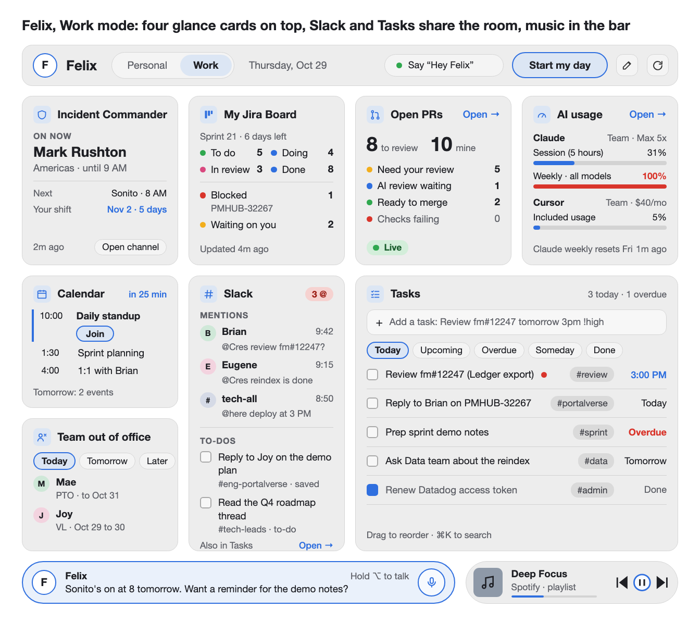
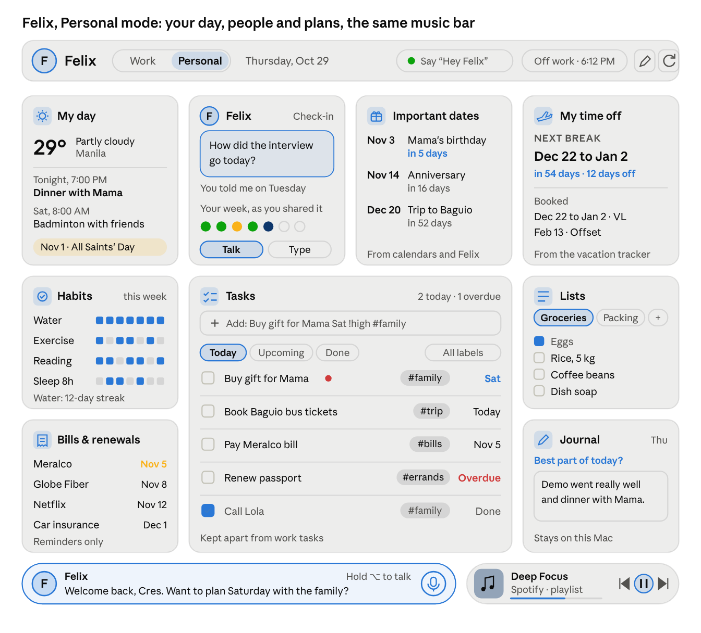

# Felix: my buddy

> Copy of the plan doc at https://claude.ai/artifact/AKv4sNUDchA8npNnx8cjTB, exported Oct 30, 2026. The online doc is the one that gets updated; refresh this copy when it changes.

Oct 28, 2026 · @Creselle John Lazo

Felix is your buddy for work and life, living on your Mac. The **Work** mode shows what a tech lead needs each morning: who is Incident Commander, your meetings, who on your team is out, your tasks, your PRs and your Jira board. The **Personal** mode keeps your own tasks, calendar, important dates, habits, journal and lists. And you can talk to Felix like a friend, about work, your day, or anything on your mind. It grew out of the Open PRs page (it was called the Tech Lead Command Center until Oct 29), runs on the same small local server, and starts when you log in.

## Progress

Checked against the code on Oct 30. Anything struck through below is built; a "(built: …)" note says how much of a partly done item is in. The phases are listed in "How we get there".

| Phase | Status |
| --- | --- |
| 1. Home page | Done |
| 2. Incident Commander | Done, except the Open channel button |
| 3. Calendar and Team out of office | Built, waiting on your Google connection (Oct 30): both cards, the vacation tracker reader with your team list, Today / Tomorrow / Upcoming / Pick dates, My team or Everyone, Manage team, and Yes / Maybe / No on invites. Two ways to connect: the Apps Script bridge (the default; PURE accounts can't create Cloud projects or turn on APIs) or your own Google Cloud OAuth app |
| 4. Tasks | Mostly (Oct 30): the Work and Personal cards on node:sqlite (data/tasks.db), quick add in plain words, Today / Upcoming / Overdue / Someday / Done with counts, label filter, PR, ticket and web links, drag to reorder, details (notes, due, priority, repeat, labels, project, subtasks, delete), repeating tasks and Mac reminders. Not yet: the full Tasks page, search box, "Add task" on PRs, keyboard shortcuts, and tasks in the backup file |
| 5. Jira | Done (Oct 30): Set up form on the card (token tried, then saved to the Keychain), the open sprint, and your tickets counted in each of the board's own columns, read from Jira. Blocked and Waiting on you were dropped (Oct 30) |
| 6. Slack and Start my day | Built, waiting on your Slack app (Oct 31): the Slack card (mentions, saved for later, watched channels' unread) with Connect Slack and a ready manifest; Start my day, breaks, End my day, the countdown and reminder, Settings and Felix commands work on this Mac; Slack posting turns on with the same token |
| 7. Layout and personalization | Partly: the default layout, full width and Fit to screen; not edit mode |
| 8. Merging and releases | Mostly: Ready to merge, Merge and the release card; not Merge blocked, history or the Claude model list |
| 9. Install as an app | Done, with an animated loading screen and the top bar right under the app's title bar |
| 10. Backup and move | Not started |
| 11. Live updates | Not started |
| 12. AI tools | Mostly: the AI selectors and Review or Fix with AI; not the offer to rerun on Cursor at the limit |
| 13. Setup wizard | Not started |
| 14. Tour | Not started |
| 15. Personal mode | Partly: the switch, the name and the shell; the personal cards are examples |
| 16. Music player | Mostly: the full player (song, seek, shuffle, repeat, volume, heart, library, open playlists, search, Up next, recently played, lyrics), voice for shuffle, repeat, playing by name and search, and turning down while Felix talks; not auto-pause in meetings, "louder" or the Start my day playlist |
| 17. Buddy | Typing done, with always-open AI sessions, the AI and model pick, and a conversation recap. Felix is an agent: he reads anything, builds in his own workbench (a picture of the changed page instead of a file list, then Apply to Felix, See the code or Discard), takes messages you send while he works without stopping, asks on a card before every change outside it, and keeps a linked memory. Voice in testing (Kokoro speaks, streaming, with Play sample in Settings). Conversation and actions (Oct 30): calendar, Jira, who's out and tasks answered from their cards, "brief me" and "wrap up my day", "the first one", undo, watchers, "that's wrong", learned phrases, leaning on lighter models near the limit, web only when asked, and "fix the failing checks". Friend mode (Oct 30): personal talk is spotted and answered as a friend, apart from work data and on a warmer model, with the crisis hotline shown first when you might be in danger, quiet hours, and check-ins on the Personal home's Felix card. Memory (Oct 30): he learns after each talk in one cheap AI step, keeps dated notes in your own words, brings the ones that fit to each question, and you can say "off the record", "forget that" or "what do you know about me", or manage it all under Settings → Memory. As an agent (Oct 30) he runs his own tests after building, Apply restarts him through a guard that puts the change back if he doesn't come back healthy, "undo the last apply" puts it back by hand, long builds aren't cut off, and Stop really stops. The wake phrase is in (Oct 30, off by default): "Hey Felix" or just "Felix", with the top bar pill, a microphone pick and sensitivity. How Felix talks is in (Oct 30): his name, your name, tone, chattiness and humor in Settings, spoken progress lines while he works, old data called out, and asking "which one?" when a PR isn't named |

## At a glance

Four glance cards sit along the top, and Slack and Tasks share the room below. The top bar holds the Work and Personal switch, Felix's listening status and Start my day, and the Felix bar along the bottom is where it answers and you can type. The names and numbers are examples. Each card opens its full page.

## Reskin (built Oct 30)

A new look for all of Felix, drawn as high-fidelity mock-ups (the reskin canvas: https://claude.ai/artifact/Y8sHGE7EmboZ95ASS8Mn3J). One design system, four themes:

- Work dark (graphite with a true blue accent) and Work light.
- Personal dark and Personal light, in olive green with warm neutrals.
- Logo 2a, the buddy face with a wink, everywhere Felix's mark shows: the top bar, the chat box, the chat panel and the app icon. The SVG files are in docs/logo.
- The bottom bar is "Floating buddy": a small pill in the middle with a round music button, and the chat grows up out of the pill. Felix's face shows when he's listening, thinking or talking.
- The AI usage card keeps today's rows (session, weekly limits, extra usage, Cursor), with a clearer order.
- Cards drop the icons in tinted squares and the all-caps labels; selection shows in a neutral colour; type sizes are 12, 13, 14, 16, 18, 24 and 28.

Built into the app: the four themes (with a Theme setting: Match my Mac, Dark or Light), the new type and corners, logo 2a in the top bar, chat, app icons and the window's title bar colour, the restyled cards and Open PRs page, the floating buddy bar with the music orb and its mini player, the chat card over a dimmed page, and the loading screen (face, smile, wink and name; no progress line).

Not drawn yet: empty and error states on the home, and the tooltips. Not built yet: Felix's listening and talking faces, and the install dialog's screenshot still shows the old look.

## Layout and personalization

The mock-up above shows the next layout, decided Oct 29. It gives the most room to the cards you work in:

- ~~Top row: Incident Commander, My Jira Board, Open PRs and AI usage.~~
- ~~Below it, the left column holds Calendar, with Team out of office below it. Slack is in the second column, as tall as the left column. Tasks takes the last two columns, just as tall.~~
- ~~The page uses the full window width.~~

An earlier idea put Calendar, Open PRs, Team out of office and Incident Commander in one row of small cards. A later one put Slack at the top right and Tasks across the rest of the second row. This layout replaces both: Slack moves down beside Calendar and spans two rows, Tasks narrows to its right, and AI usage takes Slack's old spot (decided Oct 29).

Built Oct 29: the shell follows this layout on a 12-column grid (each of the four columns above is 3 grid columns), with placeholders for the cards still to come. Medium windows show two cards per row, and narrow ones stack them. The mock-up's source is `docs/mockups/work-mode.html`.

You can also change the layout yourself:

- An Edit layout button turns on edit mode. You drag a card to move it, with a smooth animation, and drag its corner to resize it.
- The page becomes a 12-column grid, so cards snap to clean widths. (built: the 12-column grid; snapping comes with edit mode)
- You can hide a card. Every card shows by default.
- Edit mode has three buttons: Save keeps your changes, Discard drops them, and Reset goes back to the default layout.

The biggest part of this work is in the cards: each one needs a small, medium and large version of its content, so it reads well at any size you give it.

**Fit to screen** (recorded Oct 29). The app fills the window exactly, with no page scrolling, so everything is in view at once. A switch in Settings turns it on or off; it is off by default.

- ~~Rows have no fixed height. The grid shares the window's height between its rows, so a bigger screen gives every card more room and a smaller one gives less.~~
- ~~When a card's content is longer than its space, only that card scrolls, never the page.~~
- Each card picks its small, medium or large content from the space it actually gets on this screen.
- ~~With the switch off, rows take the height their content needs and the page scrolls as it does today.~~

Built Oct 29 for the home page on wide windows (1200 px and up), with the switch on the new Settings page. Narrower windows keep scrolling, since cards stack there. The small, medium and large content per card is still to come; so far the Incident Commander card adds its shifts table when it is at least 560 px wide.

## Work and Personal modes

Recorded Oct 29. With Felix as a personal buddy too, the app has two modes: **Work**, which is everything in this plan so far, and **Personal**, for your life outside work.

~~**The name: Felix.** Decided Oct 29: the whole app is now called Felix, "Felix: my buddy", replacing "Tech Lead Command Center". Felix is your buddy and the app is Felix's home, with a Work mode and a Personal mode, so there is one name on the Dock icon, the browser tab and in conversation. (Home Base, Dayboard, Harbor and Compass were the other options.)~~

**The Personal mode's cards:**

- **Tasks:** the same task manager, with personal tasks (errands, chores, things to buy) kept apart from work tasks.
- **My day:** your personal Gmail calendar, Holidays in the Philippines, and today's weather.
- **Felix:** today's check-ins ("How did the interview go?"), a quick way to talk or type, and how your week has felt, if you choose to share that.
- **Important dates:** birthdays, anniversaries, and countdowns to trips or events, from your calendars and what you've told Felix.
- **Habits:** simple daily streaks you choose, like water, exercise or reading.
- **Journal:** a few lines a day, with an optional gentle prompt from Felix. It stays on your Mac.
- **Lists:** groceries, packing and wishlist, quick to add by voice ("Felix, add eggs to groceries").
- **Bills and renewals:** due-date reminders only, with no bank accounts connected. Later this can come from Wais (below).
- **My time off:** your own leave from the Tech Team Vacation Tracker, and days until your next break.

The Personal layout: My day, Felix, Important dates and My time off across the top; Habits and Bills and renewals on the left, Tasks in the middle, and Lists and Journal on the right. Personal mode keeps the same top bar and the same bottom bar as Work, with Felix and the music player, so a song keeps playing when you switch. The top bar shows "Off work" instead of Start my day. The names and numbers are examples.

The Personal shell was built Oct 29: the switch reads **Personal | Work** (Personal first, changed Oct 29), switches the cards at once and is remembered in Settings. Every Personal card shows a dimmed example marked "Coming soon · example", and nothing reloads in Personal mode. The work cards still to come show examples the same way.

**How the modes work together:**

- They follow your day: Start my day switches to Work, End my day switches to Personal. A switch in the top bar changes it any time. (built: the switch in the top bar, remembered; not Start my day or End my day switching modes)
- After End my day, Felix stops work nudges, except urgent ones like being on call.
- Each mode has its own layout, edit mode and hidden cards. Personal data never shows in the Work mode.

**Two Google accounts** (decided Oct 29). Felix keeps two separate Google sign-ins, each allowed only what it needs:

- **Work account** (purehomeriver.com): your work calendar and the Tech Team Vacation Tracker, including answering invites. Shown only in the Work mode.
- **Personal account** (your Gmail): your personal calendar for the Personal mode, and the Google Drive backups.

Settings shows both, each with its own Sign in and Sign out, and work data never appears in Personal or the other way around.

**If you can't set up a work sign-in** (recorded Oct 29), try these in order:

1. **Sign in with your work account through your personal setup.** The OAuth client in your own Google Cloud project can also sign in your work account. Nobody at work has to set anything up. It works if your Workspace allows apps it hasn't reviewed. If not, Google shows "Access blocked: your admin hasn't approved this app", and nothing breaks. If it works, you get everything: work calendar, vacation tracker, and answering invites.
2. **If that's blocked, use your work calendar's secret iCal address.** Felix reads events from it with no sign-in, but read-only: meetings, times and usually Join links, but no answering invites. The vacation tracker has no such address, so ask its owner to share it with your personal Gmail.
3. **Share your work calendar with your personal Gmail.** Reading works if the company allows sharing outside the domain (many limit it to free/busy only). Answering invites likely won't work, since the invite belongs to your work email.

Caution for options 2 and 3: both copy work meeting details outside your work account, so check with IT or your company's data rules first. Option 1 keeps the data in your work account. The other clean path is asking IT to approve the app, which is one approval, not a full setup.

When Calendar or Team out of office runs on a fallback, the card shows a small "Read-only" label, and the Yes, No and Maybe buttons are hidden, with a tooltip saying why.

**Later: connect Felix to Wais.** Wais is your personal and shared finance planner for the Philippines (Flutter app, Supabase backend, in `~/dev/wais-app`). Once connected, the Bills and renewals card and Felix could read from it, for example "What bills are due this week?" or "How's my budget this month?", with the same facts-only rule.

**Worth checking:** this runs on your work Mac, and the Personal mode would keep personal memories, a journal and your Gmail calendar there. If the company has rules about personal data on work laptops, check them. The backup file makes it easy to move everything to a personal Mac.

## Music player

Recorded Oct 29. A music player for your own music. It lives in the bottom bar next to Felix and is the same player in both modes, so the music keeps playing when you switch between Work and Personal (decided Oct 29).

**Where the music comes from.** You connect any of these, and pick a default:

- ~~**Spotify:** your playlists, liked songs and what's playing now. Playing and controlling music needs Spotify Premium, which is Spotify's rule for apps.~~
- **YouTube and YouTube Music:** dropped for now (Oct 29); Spotify is enough.

**In the player:** artwork, song and artist, play and pause, next and previous, volume, a progress bar, and your playlists to pick from. (built, all of it, Oct 30)

Built Oct 30, in the card the orb opens (340 pixels wide, every theme):

- The song: its cover, title and artist, a progress bar you click to jump in the song, shuffle and repeat (off, all, this song) that show when they're on with the accent colour and a dot, previous, play and next, a volume slider with mute, and the device playing. A heart saves the song to Liked Songs, and a Lyrics button opens its words.
- Below it, a search box and two tabs, Up next and Recently played. With neither picked it shows your library: Liked Songs first, then your playlists. Clicking one opens it: its songs with cover, artists and length, a back button, Play from the top, and more songs as you scroll. Clicking a song plays the list from there; the button on its row adds it to Up next. The song and the list playing now are tinted.
- Search groups songs, artists, albums and playlists, a moment after you stop typing. A song plays; an album, playlist or artist opens like a playlist (an artist's list is a search for their songs, since Spotify no longer lets apps read an artist's top tracks).
- Lyrics, from LRCLIB (Spotify's own aren't in its public API): the line being sung is in full colour and weight, the ones before it faded, and they move along with the song. Click a line to jump there. Scrolling by hand stops following along until you press "Back to now". Lyrics with no timing just scroll, marked "Not synced". A Settings → Music switch turns lyrics off. Felix sends LRCLIB only the title, artist, album and length.
- Keys while the player has the focus: Space plays or pauses, ← and → jump 10 seconds (a setting), Shift with an arrow skips a song, ↑ and ↓ move between rows, Escape closes it.
- Every list has a loading, an empty and a failed state that says what to do: sign in again, Premium needed, Spotify busy (with how long to wait), or nothing playing.
- Known limit: Spotify no longer lets apps like Felix list the songs in other people's playlists (they show a plain note in place of the songs; Play is still there). Search returns fewer results than the Spotify app.

**With Felix:**

- "Felix, play my focus playlist", "pause", "next song", "what's playing?", "louder". (built: play, pause, next, previous and what's playing as local commands; since Oct 30 also "shuffle on" and "off", "repeat this song", "repeat the playlist", "repeat off", "play my focus playlist", "play the song …", "play … by …", "play …" (one of your playlists by its exact name, else Spotify's top song) and "search spotify for …"; not louder)
- ~~The music turns down while Felix is listening or talking, and back up after.~~
- It pauses by itself when a meeting or call starts, and picks up again after (a setting).
- Start my day can start a playlist you choose (off by default).

**In Settings:** connected sources and the default one, auto-pause in meetings, how much to turn it down while Felix talks, and the Start my day playlist.

Like the other services, each source is connected from the player's Connect button, not in onboarding.

## Incident Commander

One card shows who is Incident Commander right now and for today and tomorrow, and when your next shift starts. Both schedules are Kastl Incident Commanders: they take turns, so together they cover the day and the night.

- ~~**On now:** whoever is Incident Commander at this moment, and when the next handover between the two teams happens. The exact handover times come from the shifts in Datadog.~~
- ~~**Kastl Incident Commanders (Americas):** the Americas team, who take over for the Philippine night. In Datadog this schedule is named "PURE Incident Commanders Schedule". Shows today's and tomorrow's person.~~
- ~~**Kastl Incident Commanders (Philippines):** the day shift, until 10 PM Philippine time. Shows today's and tomorrow's person.~~
- ~~**Your next shift:** the date and how many days to go. In your screenshot that is Monday, Nov 2 on the Philippines schedule, 5 days away.~~
- **Open channel:** a button that opens the #incident-response channel in the Slack app. Recorded Oct 29.

~~No scraping is needed. Datadog has an on-call API that answers "who is on call at this time" for a schedule, and who comes next. It needs one Datadog access token that is allowed to read on-call data, and no API key.~~

Reading the Datadog web page stays a fallback, only if the token can't be had. It is slower and breaks when Datadog changes its page.

~~Times show in your time zone (Asia/Manila), like the Datadog page. The card refreshes every hour and just after midnight.~~

Settings (built Oct 30, in the Incident Commander section): show or hide Who's next and Your shift, how far ahead to look for your shift (14 to 60 days, 45 at first), how many days of shifts the card reads (today, today and tomorrow, or up to 7 days; the table gets a row per day), how many shifts Coming up lists (none to 5, 2 at first), the shifts table on or off, the time zone after times (off at first), how long Felix keeps Datadog's answer (15 minutes to 4 hours, an hour at first) and the card's own Refresh every.

## Calendar

The card shows today's events and the next few days, like the calendar widget on your phone.

- Each event shows its time and title, and the one happening now is marked.
- A **Join** button appears when the event has a meeting link (Google Meet, Zoom). It opens in a new tab.
- Clicking the event itself opens it in Google Calendar.
- A small countdown shows how long until your next meeting.
- Quick actions on each invite: Yes, No and Maybe buttons, a short optional note with your answer, and Propose a new time.
- More calendars: add others next to your work calendar, such as your personal Gmail calendar or Holidays in the Philippines, each with its own color.

It reads your calendar through the Google Calendar API, with one Google sign-in that can read your calendars and answer your invites. The same sign-in covers the Team out of office card. The local server checks every few minutes.

Settings (built Oct 30, in the Calendar section): days to show (today only, today and tomorrow at first, or up to 7 days, each later day under its own heading when the card has room), meetings that ended, all-day events, meetings you declined (off at first; on, they show marked Declined), the Yes, Maybe and No buttons, when Join turns into the main button (for the next meeting at first, or 15, 10 or 5 minutes before, or never), the Next in countdown, how long Felix keeps Google's answer (5 minutes at first) and the card's own Refresh every.

The API gives each event's meeting link as its own field, so the Join button doesn't have to dig it out of the description.

The card doesn't create or edit events. It only answers invites, as above. That needs a Google sign-in that can change events, not just read them.

## Team out of office

The card answers "who on my team is out?" for today, tomorrow or any dates you pick. It reads the **Tech Team Vacation Tracker** calendar.

- **Quick views:** Today and Tomorrow buttons, plus a date range picker (for example, next week while planning a sprint).
- **One line per person:** the kind of leave (PTO, VL, Offset, Birthday) and the dates, for example "Mae, PTO, Oct 5 to 16". Anyone out for the whole range is marked as such.
- **Only your team:** the card shows just the people you marked as your team. A switch shows everyone in the tracker.
- **Manage team:** a screen that lists every name found in the tracker. You tick who is on your team, rename them, and add or remove people by hand.
- **Nicknames:** the tracker writes names in different ways ("Joy M PTO", "Mervs B - PTO (Birthday)", "Cres - PTO"). Each person can have a few nicknames, so they all count as one person. The page suggests matches and you confirm them.
- **New faces:** when a new name shows up in the tracker, the card asks once whether they are on your team.
- **Upcoming leave:** a second view that lists everyone's future leave with no end limit (the next two months, or further), each with the dates it covers. Handy for sprint planning.

It uses the same Google sign-in as the Calendar card. The API also says who created each event, which helps tie a title like "Cres" to a person.

**How Felix reaches Google (Oct 30).** PURE accounts can't create Google Cloud projects or turn on APIs, so the default is a small Apps Script web app in your own Google account (the "calendar bridge", `google-bridge/Code.gs`). The card's Connect Google Calendar steps copy the script with a random key Felix made, you deploy it as a web app (Execute as Me, Who has access Anyone), and paste its address back; Felix tries it, then keeps the address and key in the Keychain. The bridge only reads your calendar and the vacation tracker and sends your reply to an invite; it can't make, change or delete events, and it answers nothing without the key. The Google Cloud OAuth app is still there as "Use a Google Cloud app instead".

The team list comes from the tracker itself. Google Calendar has no list of your team to read, so names seen in the last year's events, plus the people who created them, are offered as the starting list.

Settings (built Oct 30, in the Team out of office section): which view the card opens on and whether it shows My team or Everyone (both "the one I picked last" at first), how far Upcoming looks (2 weeks to 6 months, 2 months at first), the kind of leave, the note, "the whole time", the question about new names, how long Felix keeps Google's answer and the card's own Refresh every.

## Tasks

A full task manager, saved on your Mac. The card shows today's and overdue tasks; a Tasks page holds everything else.

- **Quick add in plain words:** "Review fm#12247 tomorrow 3pm !high #review" sets the due time, priority and tag.
- **Views:** Today, Upcoming, Overdue, Someday and Done, plus search.
- **Organize:** projects, tags, priority, due date and time.
- **Details:** subtasks, notes, and repeating tasks (every Monday, every sprint).
- **Reminders:** a Mac notification at the time you set.
- **Links:** a task can point to a PR, a Jira ticket or a meeting, and opens it in one click.
- **Quick capture:** an "Add task" button on every PR in the PR page.
- **Speed:** drag to reorder, and keyboard shortcuts for everything.
- **Labels:** tie tasks to your real projects, then filter, search and sort by label.
- **Export and import:** tasks move to a new Mac in the app's backup file, with everything else. See "Backup and move to a new Mac".

Tasks on your phone is an open question for later (see "What I need from you").

Settings (built Oct 30, in the Tasks section, for both the Work and Personal cards): which view each card opens on (the one picked last at first), which views show (Upcoming, Someday and Done on; Overdue on the Work card only at first, or both cards, or neither), whether done tasks stay in Today until midnight, whether new tasks go at the top or the bottom, the priority for a new task when you don't type one, what a bare "at 3" means (hours up to 7 are the afternoon at first), labels, links (up to 2 at first), the subtask count, the repeat mark, drag to reorder, reminders on or off and their sound (Glass at first, or none), and the Work card's own Refresh every. Tasks added by Felix follow the same settings.

## Open PRs

The card shows the counts that need you, and each count opens the PR page already filtered:

- ~~PRs waiting on your review, and those with new commits since your review.~~
- ~~AI reviews waiting on your A–D answer.~~
- ~~Your PRs with failing checks or merge conflicts, and AI fixes ready to push.~~

~~An **Open PRs** button opens the full page. The page moves under the home page (for example `/prs/review`) and keeps everything it does today.~~

More for the PR page, recorded Oct 29:

- **Ready to merge or blocked:** two new statuses. Ready to merge means approved, checks pass and no conflicts. Merge blocked shows what is in the way. (built: Ready to merge; not Merge blocked)
- ~~**Merge button:** on a PR that is ready, Merge sends it to the merge queue, which squashes it into main. It asks for a second click first, like Remove me.~~
- ~~**Release card:** each repo always has one open "chore: release main (changeset)" PR. The PR page shows it at the top, for fm and bm: the packages it releases, your PRs inside it shown as details, and its deployment status from GitHub Actions.~~ (built: in its own Releases tab, with the dev deploy and prod status)
- **History view:** your past PRs, a page at a time because the list is long. Each one shows the same details as today, its status and dates, the release PR that shipped it, whether it reached dev (from that release PR's Actions runs) and whether it reached prod.
- **Claude model list:** the model pickers fill themselves from the models the Claude Code terminal offers, so new models show up after a Claude update without a code change.

Settings (built Oct 30, in the Open PRs section). On the home card: the two totals, when each of the nine counts shows (always, only when there are some, or never; at first the four key ones always show and the rest only when there are some), which repos the card counts (both at first, or fm or bm only; the links then open the page filtered to that repo), Releases on or off (off, GitHub isn't asked for them) and the card's own Refresh every. On the Open PRs page: which tab it opens on, its first sort, grouping by repo, and how often it reloads itself (5 minutes at first).

AI usage settings (built Oct 30, in the AI usage section): show Claude, Cursor or both (a hidden tool isn't asked at all), whether Claude keeps its own warning colours, the amber and red levels (80% and 100% at first; Cursor always uses them), the spend lines in the details, how long Felix keeps the answers (2 minutes at first) and the card's own Refresh every.

## AI tools: Claude or Cursor

Recorded Oct 29. When your Claude limit runs out, reviews and fixes can run on Cursor instead. Everything named "Claude" on the PR page becomes "AI", and you pick the tool.

- **Setup wizard:** choose which AI tools to connect, Claude, Cursor or both. At least one is needed.
- ~~**Global AI selector:** on the PR page, next to the model picker. The model list follows the chosen tool, so Claude shows Claude models and Cursor shows Cursor's.~~
- **Review with AI on every PR row,** on both tabs, My PRs included. Clicking it opens the PR's details panel on the **AI Review** tab (formerly Claude review). It doesn't start a review by itself. (built: the button, but it starts the review directly instead of opening the tab)
- ~~**The AI Review tab** has its own AI selector and model picker, which override the global ones for that PR, the same way the model picker works today. The Start button lives here.~~
- **AI Fix** (formerly Claude Fix) works the same way. **Fix with AI** shows on a My PRs row only when the PR has failing checks, a merge conflict or unresolved review comments. Clicking it opens the details panel on the AI Fix tab and doesn't start a fix. (built: it opens the AI Fix tab, but shows on every My PRs row, not only failing ones)
- **My PRs gets the AI Review tab too,** so you can review your own PR before asking others.
- Each review and fix shows which tool and model ran it. (built: the tool)
- When Claude stops because its limit is reached, the page says so and offers to run it again on Cursor.

Some things work differently on Cursor, still to check: following a session from the Claude phone app is Claude-only, and the /review-pr skill is a Claude skill, so Cursor gets the same instructions passed in directly.

## Install as an app

~~Felix can open in its own window, like an app, while it still works in a browser tab. The simplest way is a Progressive Web App: Chrome shows an Install button, and the installed app gets its own Dock icon and window. If that falls short, a small wrapper app is the fallback.~~

## Backup and move to a new Mac

One export covers the whole app, not just tasks. Recorded Oct 29.

- **Export** makes one file with everything Felix keeps on this Mac: your tasks and labels, your layout and hidden cards, your settings (Start my day messages, auto refresh, model choice), your team list for Team out of office, the calendars you picked, and your AI review and fix history. Felix's memories and voiceprint stay out unless you choose to include them.
- **Import** on the new Mac brings it all back.
- **Sign-ins are left out on purpose.** GitHub, Claude, Datadog, Google, Jira and Slack are set up fresh on each Mac. Each card's Sign in or Set up button walks you through its own, except the AI tools, which onboarding connects.
- Both buttons live in Settings.

**Backup to Google Drive** (recorded Oct 29), on top of export and import:

- **Automatic and on demand.** Felix backs up to your Google Drive every day, and Settings has a Back up now button. It keeps the last two weeks of daily backups plus one per month.
- **Restore any version.** Settings → Backup lists the backups with their dates, and Restore brings one back, on this Mac or a new one.
- **Locked with your passphrase.** The backup holds personal things (tasks, journal, and Felix's memories if you include them), so it is encrypted on your Mac before upload with a passphrase you choose. Google can't read it, and you need the passphrase to restore. Felix keeps it in your Keychain; write it down somewhere safe too.
- **It uses your personal Google account.** It can be a different account from the work one used for Calendar, since this is your data, not the company's.
- **Felix only sees its own files.** It can see only the backups it made, in a "Felix backups" folder, nothing else in your Drive.
- **Same contents as export.** Sign-ins and tokens are never included. Felix's memories and voiceprint are included only if you choose.
- **Connected from Settings, not onboarding.** Back up to Google Drive has its own Sign in with Google button in Settings → Backup, like the other services. On a new Mac, onboarding imports a backup file; to restore from Drive instead, open Settings → Backup after onboarding.

## Live updates instead of polling

When a service can tell the app that something changed, the app listens for that instead of asking again and again on a timer. It is less work for both sides, and cards update sooner. Recorded Oct 29.

There is one catch: the server lives on your Mac, and most services can only send to a public web address. So each service gets the best option it allows:

- **Slack:** a live connection the app opens itself (Socket Mode), so no public address is needed. Mentions and other events arrive the moment they happen.
- **GitHub:** repo webhooks need admin rights on fm and bm, plus a public address forwarded to your Mac. Until then, the app asks GitHub "anything new since last time?", which is cheap and fast when nothing changed.
- **Google Calendar:** push notifications need a public address. Until then, it asks only for what changed since the last check.
- **Datadog and Jira:** both have webhooks, but setting them up needs admin rights. Until then, the hourly Datadog check and a light Jira check stay.

Timers stay as the fallback, and refresh on focus still catches up when you come back.

Decided Oct 29: use live updates wherever a service allows it, and show which cards are live.

- **Live badge on a card:** a card whose service is connected live shows a small Live badge at the bottom, in place of the "Updated 37m ago · 1:03 AM" line. A live card is always current, so that line isn't needed. If the connection drops, the Updated line comes back until it reconnects.
- **Auto refresh badge in the top bar:** auto refresh applies to the whole page, so its badge sits once in the top bar (for example "Auto refresh · 5 min"), not on each card. It shows only while auto refresh is on.
- **Live cards refresh too:** a live card is also reloaded on each auto refresh tick, so nothing gets out of date if an event is missed.

### A public address, kept safe

Webhooks from GitHub, Datadog, Jira and Google need a public address that reaches your Mac. Decided Oct 29: **Tailscale Funnel**. It is free on the personal plan and gives your Mac a fixed HTTPS address that doesn't change, so each webhook is set up once. Slack needs none of this.

The public address gives an attacker almost nothing:

- **Only a tiny listener is public.** The app stays private. The tunnel points to a second small listener with no pages, no login and no buttons. It accepts only incoming events, one path per service, and answers "not found" to everything else.
- **Every event must prove who sent it.** Each service signs its events with a secret that only you and the service know, and anything that doesn't match is thrown away. The secrets live in the Keychain.
- **An event only says "something changed".** The listener never acts on what an event says: no merging, posting or starting Claude. It only tells the right card to reload, and the card fetches the real data with your own tokens. So a faked event can at worst cause one extra refresh.
- **Small guards:** repeated events are dropped, request size and rate are capped, rejected requests are logged, and Settings has an on/off switch for the tunnel.
- **Your Mac must be awake.** Events sent while it sleeps are lost, so the slow timer stays as a safety net.

For the full app on your phone later, don't make it public. Use Tailscale Serve, which only your own signed-in devices can reach.

## Slack

Built Oct 31 (waiting on your Slack app): the card shows the messages that mentioned you in the last few days (who, where, when, newest first, each opening in Slack), what you saved for later, and the unread count of each channel you choose to watch. Settings → Slack: how far back mentions go, saved items on or off, the channels to watch, and how often to ask Slack.

~~What it shows is still open. The ideas so far: your unread mentions, each opening the message in Slack; your Slack to-dos and saved items, wired into Tasks so they show up there too.~~ Not built: saved items showing up in Tasks.

It works through a Slack app in the PURE PM workspace that acts as you. The card's Connect Slack steps give you a ready manifest (`slack.mjs` SLACK_MANIFEST: search:read, stars:read, users:read, channels/groups/im/mpim read and history, chat:write, users:write) to paste into "Create New App → From a manifest"; then Install to Workspace and paste the User OAuth Token (xoxp-). If the workspace needs an admin to approve new apps, that is the first step. The same token turns on Start my day's posting.

## Start my day

A button on the home page that posts your attendance to #attendance-engineering-ph as you, and sets your Slack status.

- **Start my day** posts "Good morning", "Good afternoon" or "Good evening", by the time of day, and sets you active in Slack. (built: the button and the greeting by time of day; the post waits for Slack, see below)
- ~~While your shift runs, two buttons show: Take a break and End my day.~~
- **Take a break** posts "Be right back!" and changes the look of the app, so it is clear you are on a break. The button becomes **Resume shift**, which posts "I'm back!". (built: the button becomes **I'm back** and the top bar's clock turns into an "On a break" pill; changed Oct 30 at your ask: the page itself keeps its colours, the top bar is the only sign)
- **End my day** posts "Bye for now!" and sets you away in Slack. (built: the button; the post waits for Slack)
- ~~Starting your day also starts a 9-hour countdown. When it runs out, Felix suggests you end your day, for a better work-life balance.~~ Built Oct 30: a clock in the top bar on every page (time since you started, time left), and when it runs out a note in the app with End my day and "Not yet, remind me in 30 minutes", plus a Mac notification. Felix doesn't say it out loud yet, since Settings has no "speak up on its own" switch.
- ~~A new Settings page turns the whole feature on or off and lets you change each message.~~ Built as the Start my day group in Settings: on or off, day length, breaks pause the countdown, the reminder and its "not yet" time, Post to Slack, and each message.
- ~~Felix commands~~: "start my day", "take a break", "I'm back", "end my day" and close wordings, plus "post it", "don't post" and "how long have I worked?", by text and voice, on this Mac with no AI.

~~Open question: does a break pause the 9-hour countdown?~~ Decided Oct 30: it's a setting, off by default, so the hours run from the start with breaks included.

How it works: the day lives in `data/shift.json`, so a reload or a restart keeps it, and every open window shows the same state within a few seconds. Each step changes the day on this Mac at once; its Slack message always waits for your yes (Post or Don't post under the top bar, or "post it").

Still to do: Slack posting and presence. The code is in (`chat.postMessage` to `C08HMFEDS5P`, `users.setPresence` auto and away, the token from the Keychain as `cmd-center-slack`, tried with `auth.test` by the Connect Slack setup through `/api/connect/slack`), but no Slack app token exists yet. Until one is saved, the app says "Slack posting is off until Slack is connected" and offers a Copy message button. Also not built: the Connect Slack card or setup form, Start my day and End my day switching between Work and Personal mode, and the Start my day playlist.

## My Jira Board

~~Decided Oct 29: the card shows your current sprint's tickets by status, the tickets waiting on you, and blocked tickets.~~ Changed Oct 30: the card shows the open sprint and how many of **your** tickets sit in each column, using the board's own columns and names read from Jira (Portalverse has six: To Do, In Progress, Code Review, TESTED, Blocked, Done), so it follows any change to the board. The Blocked and Waiting on you rows were dropped; their basis wasn't convincing.

It needs a Jira API token, saved from the card's Set up form (Felix tries it first, then keeps it in the Keychain). The planned Jira tab in the PR details panel uses the same token. (built)

Settings (built Oct 30, in the My Jira Board section): the board number (the Set up form saves it here now, instead of in data/connections.json), counting your tickets or the whole sprint (On your plate always lists yours), the sprint line (name and days left at first, or name and end date, name only, or hidden), the progress bar, empty columns, columns to hide by name, how many tickets On your plate lists (3 at first, or hidden), how long Felix keeps Jira's answer (a minute at first) and the card's own Refresh every.

## Setup wizard

A first-run screen that walks you through setting up Felix, so a new Mac gets going without reading a separate guide. It opens by itself on first run, from a card's Sign in or Set up button, and from Settings at any time.

**First run (onboarding)** keeps to the basics, so you're up in a few minutes (decided Oct 29):

- **First, your name.** The very first screen asks your name and what you'd like to be called (for example Creselle John, called "Cres"). Felix greets you with it, the home page says "Good morning, Cres", and every later step uses it. You can change it in Settings.
- It checks the tools it needs (GitHub CLI, tmux, Node) and shows the install command for anything missing.
- **AI tools:** you choose Claude, Cursor or both, and it checks each one is installed and signed in. These are the only accounts onboarding connects.
- It checks that fm and bm are cloned next to the project, and that the /review-pr skill is installed. The skill lives in the project's repo, and the server links it in on first start.
- If you want Felix, it sets it up: microphone permission, the voice download, your name and activation phrase, and reading a few sentences so Felix learns your voice.
- It offers to import the backup file from your old Mac (tasks, layout, settings and the rest).
- Last, it turns on notifications and start at login.

**Connecting services happens from the cards, not in onboarding.** Onboarding never asks you to connect GitHub, Datadog, Google, Jira, Slack or the Tailscale tunnel. A card whose service isn't connected yet shows a **Sign in** or **Set up** button in place of its content, for example "Sign in to GitHub" on Open PRs, "Set up Datadog" on Incident Commander, "Sign in with Google" on Calendar and Team out of office, "Set up Jira" on My Jira Board, and "Connect Slack" on the Slack card and Start my day. The button opens the setup wizard right at that one step: where to get the token or how to sign in, a box to paste a token, saved straight to the Keychain and tested at once. When it's done, the card fills in. Live updates get their own Set up button in Settings, for the Tailscale tunnel and webhook secrets. Settings also lists every service with its status and the same buttons.

**Run onboarding again** (recorded Oct 29). Settings has a **Run setup again** button that takes you through onboarding from the first screen, your name included. Nothing is wiped: each step shows what is already set, so you can keep it or change it, and skip ahead. The tour after it can be replayed the same way.

Each step shows done, missing or failed, and you can run it again. A card that isn't set up links to its step instead of only showing an error.

The wizard is the guide: each step carries the short explanation that SETUP.md has today, so onboarding happens inside the app. SETUP.md keeps only what has to happen before the page can open: install Node, clone the repo and run the install command.

## Tooltips and a tour

Recorded Oct 29.

**Tooltips on every action, most of all the ones that do things behind the scenes.** Hovering a button says exactly what will happen, so nothing is a surprise. For example:

- **Start my day:** "Posts 'Good morning' to #attendance-engineering-ph as you, sets you active in Slack, and starts a 9-hour countdown."
- **Take a break, Resume shift, End my day:** the message each one posts, and the Slack status it sets.
- **Merge:** "Adds this PR to the merge queue, which squashes it into main."
- **Push, Discard, Remove me, Fix with AI, Review with AI:** what changes on GitHub or on your Mac.
- **Open channel:** "Opens #incident-response in the Slack app."

Tooltips show your own wording from Settings, so if you change the Start my day message, its tooltip changes too. Every new action gets its tooltip when it is built.

**A short tour after setup (nice to have).** When the setup wizard finishes, a quick guided tour points at each card and the main buttons, one step at a time, with Next and Skip. You can start it again later from Settings.

## Settings: everything is yours to change

Recorded Oct 29. Every behavior in the app has a setting, with a sensible default, so nothing is fixed in code. One Settings page, grouped by card and feature (Home and layout, Incident Commander, Open PRs and AI tools, Calendar, Team out of office, Tasks, Jira, Slack and Start my day, Live updates, Felix, Backup), with a search box, a Reset button per group, and a Reset all. Settings move to a new Mac in the backup file. (built: the page with search, a Reset per group and Reset all; the sections so far are Home and layout, Auto refresh, Incident Commander, My Jira Board, Open PRs, AI usage, Calendar, Team out of office, Tasks, Music, Felix, Felix as a friend, Memory, Start my day, Connections and App. Not yet: Slack, Live updates and Backup)

Card settings (built Oct 30): every live card has its own section, described under each card above. Every default keeps the card as it was, so nothing changes until you change a setting. Each card also has its own Refresh every: with the other cards (the Auto refresh timer, at first), its own 1 minute to 1 hour, or only when you click Refresh. Where the server needs a value (the Jira board, how many days to read, declined meetings, which AI tools to ask, how long to keep each answer, where new tasks go), it reads the saved settings itself. Home and layout also has three settings for every card: the card icons, the links at a card's top right, and "Updated 2m ago" at a card's foot.

The page itself (rebuilt Oct 30): a list of sections on the left, grouped as General, Cards (in Home's order), Felix, Music, Work day and Accounts, with the section in view highlighted as you scroll; on narrow windows it becomes a row of chips at the top. Each section has its title, a one-line about and Reset. Rows are short: the name and the control on one line, the first sentence of the help under it and More for the rest. A setting that depends on another sits indented under it and dims while that one is off, and longer sections split into small headed runs (like Counts, Loading or Open PRs page) that flow into two columns on wide windows. Search filters the list and the rows together and says when nothing matches, and /settings#jira (or any section's id) lands on that section.

Built Oct 29 at `/settings` (the gear in the top bar), with the first two groups: Home and layout (mode, Fit to screen) and Auto refresh (on or off, every 1 to 15 minutes). Each setting is one entry in `public/settings-schema.mjs`, which the server and the page share; values live in `data/settings.json`, every change saves at once, and open home pages pick it up without a reload.

For Felix that means: its name, activation phrase, AI tool and model, voice, speed, push-to-talk key, microphone, spoken or text replies, interrupt words and how sensitive interrupting is, which local commands are on, learned phrases, voice learning (on or off, train again, forget my voice), spoken alerts and which events trigger them, whether to keep conversation history, plus friend mode, tone, memory, progress lines and the voice, all described under Buddy.

One exception, on purpose: actions that post as you, merge or push always ask before they happen. Settings can change how they ask (by voice, by click or both), but not turn the asking off.

## Buddy (future)

Recorded Oct 29, for later. A buddy you talk to, named Felix by default. You can rename it in Settings. You say your activation phrase (or hold a key, or click the mic), speak, and it answers out loud and on screen. It is not always listening: it only wakes up when it hears your phrase. It runs on the AI tool chosen in Settings, Claude by default: Haiku 5.5 for quick questions, Sonnet 5.5 for bigger asks and personal talk (see "Which model Felix uses"). For work, it uses the app's own features, so it knows what the cards know and can do what the buttons do. It can also search the web when you ask, and it is someone to talk to about your day, not just your work. (built: typing, voice through the mic button with replies read aloud, in testing, and the activation phrase, off by default; not web search or personal talk)

**What it can answer:**

- ~~"Who's on call?", "When is my next shift?", "Who takes over tonight?"~~
- ~~"What's my next meeting?", "Am I free at 3?", "What's on tomorrow?"~~
- ~~"Who's out today?", "Who's on leave next week?"~~
- ~~"How many PRs need my review?", "What's failing on my PRs?", "Summarize fm#12247."~~
- ~~"Did my PR reach prod?", "What's in the current release?"~~
- "What's blocked in the sprint?", "What's waiting on me in Jira?" (built: "what's on my plate" lists your open tickets, and any Jira question reads the board)
- "Any Slack mentions?", "What tasks are due today?" (built: tasks; not Slack, which isn't connected)

**What it can do**, always confirming first when something leaves your Mac:

- Start my day, take a break, resume, and end my day.
- "Add a task: review the release notes tomorrow at 3, high priority."
- ~~"Review bm#14270 with Cursor." "Fix the failing checks on my PR."~~ (built: both ask first; a fix commits on its own branch and never pushes)
- ~~"Merge fm#12259." It reads back the PR and waits for your yes.~~
- "Accept the 2 PM meeting", "Decline and say I'm on call", "Join my next meeting." (built: accept, decline or maybe, with a note, each after your yes on a card; not joining)
- "Open #incident-response." "Show my PRs with conflicts." "Turn on auto refresh." (built: showing PRs with conflicts and turning auto refresh on; not opening the Slack channel)

**Briefings:** (built Oct 30: both read every connected source and say which aren't connected; Slack isn't yet) "Brief me" gives a short morning rundown: your shift and who's on call, today's meetings, who's out, PRs that need you, sprint blockers and tasks due. "Wrap up my day" sums up what got done before End my day.

**Speaking up on its own** (off by default): it can say important moments out loud, like "Claude's review of fm#12247 is ready" or "Your 9 hours are up."

**Settings for it:** on or off, AI tool and model, voice and speed, the push-to-talk key, whether replies are spoken or text only, its name (default Felix), the activation phrase that wakes it (default "Hey Felix"; it follows the name unless you write your own phrase), and which microphone to use. It understands and speaks English only. (built: on or off, AI and model, voice and speed, spoken or text, the name, the activation phrase that wakes it (off by default, with "also wake on just the name" and a sensitivity), and the microphone; not the push-to-talk key)

**Why Felix:** a friend should have a person's name, and Felix means "happy", which suits a buddy you share good news with. It is two clear syllables that are easy to say and hard to mishear, so the phrase spotter catches "Hey Felix" reliably, and it isn't the name of anyone on your team or of another assistant. Chosen Oct 29, replacing Orion; Elliot, Jasper and Theo were the other picks.

**Voice selector:** Settings lists every voice you can use, each with a Play sample button, and you pick the one you like. Only free voices, and the most natural ones first:

- **Kokoro** (the default): a free, open-source voice model that runs on your Mac. It sounds the most human of the free options, has several English voices, and nothing leaves your Mac.
- **Piper:** another free voice engine that runs on your Mac. It's lighter and faster, a little less natural, and has many English voices.
- **macOS voices:** built into your Mac, nothing to install. The Premium and Enhanced voices (a free download in System Settings → Accessibility → Spoken Content) sound much better than the standard ones.

Paid voices (like ElevenLabs) are left out on purpose.

**Safety:** it shows what it heard and what it plans to do before acting. Anything that posts, merges, pushes or answers an invite needs your yes, spoken or clicked. Each request uses your AI plan's usage, like any other session. (built: merge and review ask first, with a yes by click, or by voice in testing)

**What it costs, and saving AI usage.** Claude doesn't run all the time. Listening for "Hey Felix", turning your speech into text, and speaking the answer all happen on your Mac, for free. Only understanding and answering uses your AI plan, one request per thing you ask. To save even that, simple commands are handled on your Mac with no AI at all: "Start my day", "Take a break", "End my day", "Who's on call?", "What's my next meeting?", "Open #incident-response", "Show my PRs with conflicts", "Turn on auto refresh" and the like. Claude (or Cursor) is called only for real questions and open-ended asks, like "Summarize fm#12247" or "Brief me". Recorded Oct 29.

**Which model Felix uses** (decided Oct 29). On your Claude subscription there is no per-token bill; each request uses part of your plan's usage limit, and smaller models use much less of it. Claude Code's "Default" model is one fixed model for your account; it does not pick a cheaper model for easy questions. So Felix pins its own:

- **Haiku 5.5 by default:** the fastest and lightest model, which matters for a voice reply, and plenty for "who's on call" or "add a task".
- **Sonnet 5.5 for bigger asks:** "Brief me", "Summarize fm#12247" and "Wrap up my day" move up automatically.
- ~~Both choices, and when to move up, are in Settings.~~

~~Update, Oct 29: the default is now **Auto**, which uses Claude Code's Sonnet while your Claude plan has room and switches to Cursor's Sonnet once a Claude limit is used up, so Felix never spends Claude's paid extra usage. An explicit pick falls back to the same Claude model on Cursor. Composer 2.5 and Composer 2.5 Fast can be picked too. Each answer shows which model wrote it.~~

~~Update, later Oct 29: Settings pick the **AI** (Auto, Claude or Cursor) and then the **Model**, from the same lists as Open PRs. Auto uses Claude while the plan has room and Cursor past a limit. With the model on Auto, Felix picks per question: Sonnet for quick ones and Opus for ones that need thought (summaries, explanations, why, advice, comparisons, what a PR changes); on Cursor, Composer 2.5 Fast (its own usage pool) and Cursor's Opus. Auto doesn't use Haiku, whose replies read stiffly.~~ (built)

Rough size, priced as if billed per token: a typical request (about 8,000 tokens in, 400 out) is about $0.001 on Haiku 5.5, $0.02 on Sonnet 5.5 and $0.04 on Opus 5.5. Fifty requests a day for a month is about $1 on Haiku, $22 on Sonnet and $44 on Opus. Local commands cost nothing, and caching makes repeat requests cheaper still.

**Facts only, never made up** (recorded Oct 29, a hard rule). Felix answers only from real data it just read. Made-up or wrong data is not allowed, so it is built to say "I don't know" rather than guess.

- ~~**Every answer comes from the source.** A question is first matched to the source that holds the answer: Datadog for on-call, Google Calendar for meetings, GitHub for PRs and releases, Jira for tickets, Slack for mentions, and your tasks. Felix reads that source right then, and answers only from what came back. It never answers facts about your work from the AI's general knowledge.~~
- ~~**No data, no answer.** If a source can't be reached, has no data, or the data is too old, Felix says so plainly ("I couldn't reach Datadog, so I can't say who's on call"). It never fills the gap with a guess.~~
- ~~**Every fact is checked before you hear it.** Before an answer is spoken, every name, number, date, time, PR number and ticket key in it is matched against the data that was read. If anything doesn't match, the answer is thrown away and Felix says it can't confirm it.~~
- ~~**It shows where each fact came from.** On screen, every answer has source chips, such as "Datadog · 11:29 PM", that open the real record. You can ask "Where did you get that?" at any time. Old data is called out ("as of 10 minutes ago").~~ (built Oct 30: old data shows in the chip, local answers add "That's as of 10 minutes ago", and the AI is told to say it)
- ~~**When unsure, it asks.** If a question could mean two things ("which PR?"), it asks instead of picking one.~~ (built Oct 30: a rule in the AI's prompt, and "merge my PR" or "review a PR" ask which one when more than one could be meant)
- ~~**Web only when you ask, always named.** Felix searches the internet only when you ask it to ("look up", "search the web", "what's the news on"). Every web answer says where it came from and when, for example "According to Reuters, today", and keeps web facts apart from your own work data. If the sources disagree or it finds nothing solid, it says so instead of choosing a story.~~ (built: the gate turns web tools down unless you asked; whether sources disagree is up to the AI)
- **Summaries quote the real thing.** "Summarize fm#12247" reads the PR's actual description, diff and comments, and says nothing that isn't in them.
- ~~**Common questions skip the AI.** Answers like "Sonito is on until 10 PM" are filled straight from the data with a fixed sentence, so there is nothing to make up.~~
- ~~**Tested.** A set of questions with known answers runs before each change to Felix, so a slip is caught before it reaches you.~~

**It tells you when it's working** (recorded Oct 29). When an answer takes more than a moment, Felix says so right away, so you never wonder whether it heard you.

- ~~After about a second and a half with no answer, it says a short line such as "Pulling that up", "Hold on, checking Datadog" or "One moment, reading the PR".~~
- ~~The line names what it is really doing, never a made-up step, to keep the facts-only rule.~~
- ~~For longer work it gives an update every few seconds, such as "Still reading the diff" or "Almost there", and doesn't repeat the same line twice in a row.~~ (built without "Almost there", which Felix can't know)
- ~~The same progress shows on screen as a small status line.~~
- ~~You can interrupt these lines like any other speech.~~ (built: Stop talking, Stop and Escape end them; talking over Felix comes with barge-in)
- ~~In Settings: on or off, how long to wait before speaking, how often to update, and your own list of phrases.~~

**How fast it is** (measured Oct 29 on this Mac). Times run from when you stop talking to when you hear Felix's first word.

- **Simple commands, no AI** ("Who's on call?", "Start my day"): about 1 to 1.5 seconds.
- **Quick AI questions on Haiku** ("Am I free at 3?"): about 2.5 to 4 seconds.
- **Bigger asks on Sonnet** ("Brief me", "Summarize fm#12247"): about 6 to 15 seconds, with progress lines while it works.

How it stays fast:

1. **A warm session.** Claude is started before you speak and kept running through the conversation, with a spare one waiting for the next. That makes each reply about three times faster than starting Claude fresh. (built Oct 29: one warm Claude session per model, and one Cursor session, `cursor-agent acp`, that switches models between questions. The app keeps them warm while it's open and in view, and a session that's had 20 questions is replaced in the background.)
2. **It speaks as it writes.** Felix starts saying the first sentence while Claude is still writing the rest. On screen the reply streams in with a typing effect, each sentence checked against the facts before it shows (built Oct 29).
3. **It answers from data the home page already holds.** The cards keep on-call, PRs and calendar fresh, so most answers need no new fetch. Built Oct 29 for PRs, the slowest source (about 2.5 seconds from GitHub): a shared cache that the Open PRs card's reloads keep fresh, used as is under a minute old and served at once while it reloads up to 5 minutes old. Checking GitHub went from about 2.5 seconds to 0.3.
4. **Simple commands skip the AI, and quick questions use Haiku.**

**Interrupting it.** Felix keeps listening while it talks, so you can cut in like with a person. Say "stop" or "wait", say its name, or just start talking, and it stops speaking at once and listens to you. It must never hear itself and think you spoke, so it removes its own voice from what the microphone picks up, and ignores any words that match what it is saying right then. Headphones make this perfect; on the Mac's speakers it still works, with a little more care. Recorded Oct 29.

**Felix learns** (recorded Oct 29). Everything it learns stays on your Mac, and you can see it, change it or wipe it in Settings.

- **Your voice:** in Settings you read a few short sentences once, and Felix learns how you sound. After that, only your voice can wake it, interrupt it or give it commands, so people talking nearby, a video or a meeting on speaker don't set it off. It keeps getting better from the commands you give it, and you can train it again or forget your voice at any time.
- ~~**Your way of saying things:** when you ask something the local commands don't know, and the AI works out it meant one of them ("I'm heading out" meaning End my day), Felix offers to remember that phrase. Next time it runs on your Mac, with no AI usage. You can review and remove learned phrases in Settings.~~

### Felix as a friend

Recorded Oct 29. Felix is not only a work buddy. You can tell it about your day, share good news, talk through a problem, or just vent, and it listens like a close friend: warm, patient, on your side, and honest.

- ~~**It remembers what matters to you.** Everything you share (your family, a big event coming up, something that's been weighing on you) is learned and remembered automatically, so it can ask later how it went. See "How Felix remembers" below. It only remembers what you told it, never fills gaps by guessing, and says so when it doesn't remember.~~
- ~~**It is honest, even when kind.** It can cheer you on, sympathize and give its view, but it won't invent facts or pretend to know things it doesn't.~~
- **Private by design.** Personal talks are kept apart from work data and stay on your Mac, except for the AI request itself. You can say "off the record" so nothing is remembered, and you can see, edit or delete everything it remembers in Settings. Personal memories are left out of the backup unless you choose to include them. (built: personal talk reads no work card and brings only personal notes, and the rest; not the backup part, since backups aren't built yet)
- ~~**A friend who wants you to have other friends.** If you're going through something heavy, it stays with you in the conversation, and also gently encourages you to reach out to people you trust. If you ever sound like you might be in danger, it shares how to reach real help right away, such as the NCMH crisis hotline 1553 in the Philippines.~~ (built: a fixed message with 911 and NCMH 1553 comes first, then the AI; what's said then is never logged or learned)
- ~~**A warmer model for personal talk.** Personal conversations use Sonnet 5.5 by default, since they need more care than "who's on call". This is a setting too.~~ (built: Sonnet on Claude, Cursor's Sonnet on Cursor)
- ~~**In Settings:** turn friend mode on or off, Felix's personality and tone, what it may remember, the model for personal talk, and quiet hours when it won't bring personal things up on its own.~~ (built in a "Felix as a friend" group: personality is warm, cheerful, calm or straight-talking; what it may remember is everything or work only)

### How Felix talks

Recorded Oct 29. Felix sounds like a friend, not a machine: natural, friendly and relaxed, never stiff.

- ~~**Like a person talks.** Short sentences, everyday words and contractions ("you're", "it's"). It calls you by your name now and then, not in every line.~~ (built: your name is a setting, empty by default)
- ~~**The answer first.** "Sonito's on until 10 tonight", not "Based on the current Datadog on-call schedule, the responder is...".~~
- ~~**No robot filler.** No "Certainly!", "As an AI", "I hope this helps" or reading out lists with bullet numbers.~~
- ~~**It varies.** It doesn't greet you the same way every morning, and even the fixed answers for common questions have several natural wordings that rotate.~~ (built: three or more wordings for the common local answers)
- ~~**Spoken the way people say it.** "Ten PM", "tomorrow morning" and "in about twenty minutes" instead of "22:00" or "2026-10-29". Long PR titles are shortened, and links are shown, not read out.~~ (built: the rules, plus the voice turning "22:00", "2026-10-29", markdown and links into speech, and PR numbers said in pairs, "F M 1 22 47")
- ~~**It reads the room.** Upbeat when you share good news, gentle when you're stressed, brief when you're busy, a bit of humor when it fits.~~ (built as a rule in the AI's prompt)
- ~~**Still facts only.** A friendly tone never comes at the cost of the truth.~~
- ~~**In Settings:** tone (casual, balanced or professional), how chatty it is, and how much humor.~~ (built Oct 30, with Felix's name, your name and the activation phrase's words)

### How Felix remembers

Recorded Oct 29. Felix learns from everything you share, work and personal, and remembers it, the way a good friend does. It does this cheaply and without slowing down your conversations.

- ~~**It learns after you talk, not during.** When a conversation ends, Felix quietly writes down what's worth keeping: people in your life, things you like and dislike, events and their dates, what's going on with you, your plans, and how you like to work. One small, cheap AI step per conversation, not one per sentence.~~ (built: after 10 quiet minutes, a setting; Haiku on Claude, Composer 2.5 Fast on Cursor)
- ~~**Small notes, not whole transcripts.** Each memory is one short fact, with the day you said it and your own words it came from. When something changes ("I moved to a new team"), the old note is updated, and the history is kept.~~
- ~~**It recalls only what fits the moment.** Each time you talk, Felix looks up just the few memories that matter for this conversation and brings those along, plus a short "about you" summary. So a chat about your weekend doesn't drag in your sprint, and requests stay small and fast.~~ (built with word matching, not an embedding model)
- ~~**It tidies up while you're away.** When the Mac is idle, Felix merges duplicates, turns repeated mentions into stronger memories, and lets small, old details fade into an archive. Nothing is thrown away unless you ask.~~
- **It follows up.** A memory with a date, like "my interview is on Friday", becomes a gentle check-in afterwards ("How did the interview go?"), outside your quiet hours. (built: asked once, when you greet Felix after the day has passed; not quiet hours or the Personal home's check-in card, which come with friend mode)
- ~~**It's honest about memory.** It says "you told me on Oct 12" when it uses a memory, and "I don't remember you telling me that" when it has nothing. It never guesses, and never infers private things you didn't say.~~
- ~~**Secrets are never kept.** Passwords, codes, card numbers and similar are filtered out before anything is saved.~~
- ~~**You're in control.** "Off the record" saves nothing. "Forget that" deletes it. "What do you know about me?" reads it back. Settings has a memory page to search, edit, delete or export everything, and a switch to pause learning.~~ (built, also "forget about <something>", which asks first, and "stop learning")
- **It all stays on your Mac.** The memories live locally. Only the few relevant ones travel with an AI request. (built: `data/felix/notes.json`; the learning step sends the conversation to the AI once more, the same text it already saw)

### More that makes Felix better

Recorded Oct 29, all thirteen chosen.

**Getting the basics right**

- **Knows when to stay quiet.** Felix never speaks up on its own during a meeting or a call. It knows from your calendar, and from Zoom, Meet or Slack huddles using the microphone. Someone saying "Felix" in a meeting doesn't wake it. It also pauses when your screen locks or you step away, and picks up when you're back.
- **Gets your names and words right.** Felix keeps a small dictionary of your team's names (Sonito, Ronniel, Jamsed and the rest) and your work words (PMHUB, fm, bm, Datadog), so it hears them correctly and says them correctly. It fills itself from the people and terms already in the app, and you can fix any entry in Settings.
- ~~**Follows the conversation.** "Who's on call?" then "And tomorrow?", or "Show my failing PRs" then "Fix the first one": Felix keeps track of what "it", "that one" and "tomorrow" mean while you talk.~~
- ~~**Keeps working when AI is out.** If the Claude limit is reached or the internet drops, Felix tells you, still does all the local commands, and switches to Cursor if you've allowed that. It never just goes silent.~~
- ~~**Typing mode.** When you can't talk, the same Felix, with the same memory, works in a chat box on the page.~~

**Doing more for you**

- ~~**Watch and tell me.** "Tell me when CI passes on my PR" or "Let me know when Brian approves" sets up a watcher that speaks up when it happens, and shows on screen too. You can list and cancel watchers.~~ (built for PRs: checks passing or failing, an approval, ready to merge)
- ~~**Undo.** "Undo that" reverses the last thing Felix did on your Mac, like adding a task or changing a setting. Things that already left your Mac, like a Slack post or a merge, can't be undone, and Felix says so.~~
- **Drafts messages for you.** "Tell Brian I'll review after lunch" gives you a Slack message to read, change and approve before it is sent.
- ~~**Shares your usage budget wisely.** Felix and the PR reviews use the same Claude limit. Felix shows how much it has used, slows down near the limit by leaning on local commands and Haiku, and leaves room for reviews.~~ (built: shown in Settings → Felix; at 80% by default, Haiku for quick questions and Sonnet for bigger ones)
- ~~**Learns from its mistakes.** Say "that's wrong" or tap thumbs-down, and the mistake is saved into the test set, so it gets fixed and stays fixed.~~ (built: saved to `data/felix/evals.jsonl`; turning those into test cases is still by hand)
- **Moves around the app for you.** "Open my PRs", "Show PRs waiting on me with failing checks", "Open fm#12247's files", "Go to Tasks", "Switch to Personal", "Open Settings", "Edit the layout", "Open the Datadog schedule", "Open #incident-response". Felix opens the page, applies the filters, opens the right panel tab or the outside link, and says what it opened. Navigation needs no confirmation, since nothing leaves your Mac, and most of it runs as local commands with no AI. (built: pages, PR filters, a PR, Settings and the mode; not Edit the layout or outside links)

**Being a good friend**

- **An honest friend, not a yes-man.** Felix gently tells you when it thinks you're wrong, instead of always agreeing.
- **Light care for your day.** An opt-in nudge after a long stretch without a break, tied to the 9-hour countdown. A few a day at most, never during meetings, never naggy.
- **Clear status at a glance.** A small icon shows whether Felix is listening for its name, listening to you, thinking or speaking. A mute key and "pause for 30 minutes" are always one step away. (built: the mic button shows when it is listening, and the top bar's "Say “Hey Felix”" pill shows listening for the name, off, or no microphone permission, and turns it on or off; not the mute key or the pause)

Each of these has its own switches in Settings.

## How we get there

We build it in phases, each one usable on its own. A phase can start as soon as its keys or decisions are ready.

Built on Oct 28: phase 1 (the home page, with the PR page moved to /prs) and phase 2 (Incident Commander). The other cards are placeholders for now.

Next up, recorded Oct 28 and 29, not started:

- Notifications from the home page. Today, PR notifications only come from an open Open PRs tab. They should also come when only the home page is open.
- ~~Refresh on focus. When you come back to the window, the home page refreshes its cards.~~
- A new layout, and moving cards yourself. See "Layout and personalization" near the top. (built: the new default layout; not moving cards)
- ~~Full width. The home page uses the whole window width instead of a centered column.~~
- ~~Auto refresh. The home page reloads its cards on a timer. In Settings you turn it on or off and set how often. Built Oct 29: on by default, every minute (as asked on Oct 29, replacing the earlier plan of off by default and every 5 minutes), about 16% of the GitHub limit an hour. It skips the reload while the window is hidden, and only runs in Work mode.~~

1. ~~**The home page.** Done Oct 28: a grid of cards at `localhost:4777`, the PR page moved under it, the Open PRs card live, and the other cards as placeholders.~~
2. **Incident Commander.** Done Oct 28: today, tomorrow and your next shift. Still to add: the Open channel button.
3. **Calendar.** Today and the next few days with Join buttons, invite quick actions (Yes, No, Maybe, a note, propose a new time) and extra calendars, once the Google sign-in is set up. Team out of office, with its upcoming leave view, comes in the same phase, using the same sign-in.
4. **Tasks.** The full task manager with labels, filters and sorting, the card, and "Add task" on PRs. This is the biggest phase.
5. **Jira.** The board card, plus two PR-page features paused for this plan: the Jira tab in the details panel and the Team view tab (everyone's open PRs, stale ones, review load, and a Nudge button that copies a Slack message).
6. **Slack and Start my day.** The Slack card, the attendance buttons with the break look and the 9-hour countdown, and the Settings page.
7. **Layout and personalization.** The new default layout at full width, then edit mode: drag, resize, hide, save, discard and reset, with small, medium and large versions of each card. (built: the default layout at full width and Fit to screen; not edit mode or the card sizes)
8. **Merging and releases.** Ready to merge and Merge blocked, the Merge button, the release card with deployment status, the paged history view, and the self-updating model list. (built: Ready to merge, the Merge button and the release card; not Merge blocked, the history view or the Claude model list)
9. ~~**Install as an app.** The Install button and its own window, with the browser tab still working.~~
10. **Backup and move.** Export and import of everything the app keeps, without the sign-ins, plus encrypted daily backups to Google Drive with restore.
11. **Live updates.** Slack's live connection, the webhook listener behind Tailscale Funnel with signature checks, the Live badges, and the top bar auto refresh badge.
12. **AI tools.** Claude or Cursor for reviews and fixes: the AI selectors, Review with AI and Fix with AI that open their tabs, and the limit-reached switch to Cursor. (built: the global and per-PR AI selectors, Review with AI and Fix with AI; not the limit-reached switch)
13. **Setup wizard.** A first-run screen that checks and sets up everything above, with the setup guide built in. Not started; it comes after the cards it sets up.
14. **Tour (nice to have).** A short guided tour of the cards and buttons right after the wizard. Tooltips are not a phase: each action gets its tooltip when it is built.
15. **Personal mode.** The Work and Personal switch, the new app name, and the personal cards: Tasks, My day, Felix, Important dates, Habits, Journal, Lists, Bills and renewals, and My time off. (built: the switch and the name; the personal cards are only examples)
16. **Music player.** The Music player with Spotify, voice control through Felix, and auto-pause in meetings. Built Oct 29: sign-in in Settings → Music, the player in the bottom bar (Spotify plays right in Felix through the Web Playback SDK, and keeps playing between pages because each page loads inside a lasting outer page) and playlists. Still to come: volume, voice control, auto-pause in meetings, turning it down while Felix talks, and the Start my day playlist. (built since: turning it down while Felix talks, and play, pause, next, previous and what's playing through Felix; Oct 30: the full player with shuffle, repeat, seeking, volume, saving songs, opening playlists, Liked Songs, search, Up next, recently played, keyboard keys and lyrics from LRCLIB, and shuffle, repeat, play by name and search through Felix. Still to come: auto-pause in meetings, "louder" and the Start my day playlist)
17. **Buddy (future).** Talk to Felix: questions, actions with confirmation, briefings, and its own Settings. (built: typing, questions, actions with confirmation and its Settings group; voice in testing; not briefings)

Later ideas: connecting Felix to Wais, a phone-friendly version reached privately over Tailscale, and tasks on your phone.

## What I need from you

Keys go into your Mac's Keychain with one command each, which asks for the value without showing it. Please don't paste keys into chat.

- [x] **Datadog token:** done on Oct 28. One personal access token with only the `on_call_read` scope, and no API key (your Datadog role can't make API keys).
- [ ] **Google sign-in:** two sign-ins. Work: a Google Cloud OAuth client of type "Desktop app", user type Internal, in a project under purehomeriver.com, for your work calendar and the Tech Team Vacation Tracker; if your Workspace blocks unapproved apps, ask IT to allow it. Personal: a Desktop app client in your own free Google Cloud project, user type External and published "In production" (not "Testing", whose sign-ins expire every 7 days), for your personal calendar and Drive backups; Google shows an "unverified app" warning once, which is fine since only you use it. No iCal addresses are needed.
- [ ] **Jira token:** an API token from your Atlassian account (Security → API tokens), plus the email you sign in to Jira with.
- [ ] **Decide:** should tasks reach your phone? Options: not at all, Google Tasks, or Apple Reminders.
- [x] **Decide:** what the My Jira Board card should show. Decided Oct 29: sprint tickets by status, tickets waiting on you, and blocked tickets.
- [ ] **Decide:** who is on your team to start with. The Manage team screen will offer every name in the tracker; you only tick.
- [x] **Decide:** keep the app at `localhost:4777`, with the PR page under it.
- [ ] **Slack app:** a Slack app in the PURE PM workspace that can post as you and set your status. If the workspace needs admin approval for new apps, ask an admin.
- [ ] **Decide:** what the Slack card shows. (Whether a break pauses the 9-hour countdown is now a setting, off by default.)
- [ ] **Decide:** whether to ask for admin help to set up webhooks (GitHub, Datadog, Jira) and a public address forwarded to your Mac, or to stay with light polling for those.
- [ ] **Tailscale:** a free personal Tailscale account on this Mac, for the public webhook address (and phone access later).
- [ ] **Check:** with whoever runs security, that receiving company webhooks through a personal tunnel is OK.
- [x] **Cursor CLI:** install Cursor's command-line agent (the Cursor app alone isn't enough) and sign in to it. Done: installed and signed in, and Felix and reviews use it.
- [x] **Decide:** Felix on Cursor: use Cursor's Auto mode, or pin its cheapest fast model? And is your Cursor a personal plan or the company's Teams plan? Decided Oct 29: Auto uses the same Claude model on Cursor once Claude's plan is used up, and Composer 2.5 or 2.5 Fast can be picked. Still open: whether your Cursor is a personal plan or the Teams plan.
- [x] **Decide:** the app's new name. Decided Oct 29: Felix ("Felix: my buddy").
- [ ] **Check:** whether company rules allow personal data (memories, journal, Gmail calendar) on your work Mac.
- [ ] **Decide:** which Google account holds the Drive backups (your personal one is suggested), and choose a backup passphrase.
- [ ] **Try:** signing in your work account through your personal Google setup. If it's blocked, decide between asking IT to approve the app and the read-only iCal fallback (after checking the company's data rules).
- [x] **Music:** a free Spotify developer app and Spotify Premium.

## Technical notes

**Where it lives.** The same Node server in `repo/pure-tech-lead-cmd-center` (LaunchAgent `local.pure-tech-lead-cmd-center`, port 4777). Each data source becomes its own module (`datadog`, `calendar`, `tasks`, `github`, `jira`) with a cache and a refresh interval. The home page asks each one separately, so one failing card doesn't block the others.

**Secrets.** macOS Keychain, service names like `cmd-center-datadog-app`, saved with `security add-generic-password -s <service> -a <account> -w` (it prompts for the value). The server reads them with `security find-generic-password -s <service> -w`. Nothing is written to disk in plain text.

**Skills.** The skills review sessions need (today only `review-pr`) live in the repo under `skills/`. On start, the server links each one into `repo/.claude/skills/` if it isn't there yet. A link, not a copy, so edits on one Mac land in git.

**Incident Commander.** Built in `datadog.mjs`. `GET https://api.us5.datadoghq.com/api/v2/on-call/schedules/{schedule_id}/responders` with `include=responders.shifts.user`, `filter[position]=current,next` and `filter[at_ts]=<RFC 3339 time>`. Auth is one personal access token (scope `on_call_read`) in the `DD-APPLICATION-KEY` header, kept in Keychain as `cmd-center-datadog-app`; no API key. Each lookup returns the shift on at that time, or else the next one (while someone is on, "next" skips to the next different person), so the server steps from shift end to shift end: today and tomorrow, plus up to 45 days ahead on the Philippines schedule for your next shift. The token can't read `/api/v2/current_user`, so "you" is your Datadog user id. Cached for an hour and per day. Schedule ids: PURE Incident Commanders Schedule `a39cd3b9-f39f-4c6c-8c2f-017fca628d36`, Kastl Incident Commanders (Philippines) `1a2e4a4e-f27a-424c-999e-1cb8d6062c85`. Sources: [responders API](https://docs.datadoghq.com/api/latest/on-call/get-on-call-responders-for-a-schedule/), [personal access tokens](https://docs.datadoghq.com/account_management/personal-access-tokens).

The Open channel button is a Slack deep link, `slack://channel?team=TRA9H4H8D&id=<channel id>`, which opens the Slack app on that channel. It needs #incident-response's channel id, still to look up. It works without the Slack app integration.

**Calendar.** Google Calendar API with one Desktop OAuth client, scope `calendar.readonly`; the refresh token is kept in Keychain as `cmd-center-google-oauth`. `events.list` on `primary` with `singleEvents=true` (Google expands repeating events, so no iCal library is needed) and `orderBy=startTime`, every 5 minutes. The Join link is `hangoutLink`, or the video entry in `conferenceData.entryPoints`.

**Team out of office.** Calendar API `events.list` on the tracker's calendar id with `timeMin`, `timeMax` and `singleEvents=true`. Leave entries are all-day events whose end date is exclusive. Titles are parsed as `<name> [-] <kind> [(<note>)]`, with kind one of PTO, VL, Offset or SL; anything else shows as written. People live in `data/team.json` as `{ id, name, nicknames[], emails[], onTeam }`. Matching tries an exact nickname first, then the event creator's email, then a first-name suggestion you confirm. The tracker's calendar id is `c_jieq9t3t5r8c2ino7235kp71vo@group.calendar.google.com`, read with the same sign-in and scope as the Calendar card: `calendar.readonly`. The refresh token is kept in Keychain as `cmd-center-google-oauth`.

**Tasks.** Node's built-in SQLite (`node:sqlite`, Node 22.5+; you run 24) in `data/tasks.db`. Tables: tasks, projects, tags, task\_tags, links. Repeating tasks store a rule and create the next one when done. Reminders: a server timer sends a Mac notification (osascript) even when the page is closed; the page shows one too when open. Quick add parses dates, `!priority` and `#tag`.

**Open PRs.** Reuse `/api/prs` and `/api/reviews`. Routes move from `/mine` and `/review` to `/prs/mine` and `/prs/review`, and the old ones redirect.

**Jira.** REST v3 on `purepm.atlassian.net` with basic auth (email + API token): `/rest/api/3/issue/{key}` for the panel tab, and the agile board and sprint endpoints for the card, once its content is decided.

**Slack.** Slack Web API with a user token (`xoxp-`) from a Slack app, kept in Keychain as `cmd-center-slack`. Posting as you: `chat.postMessage` to #attendance-engineering-ph (channel `C08HMFEDS5P`, workspace `TRA9H4H8D`), scope `chat:write`. Status: `users.setPresence` with `auto` when the day starts and `away` when it ends, scope `users:write`. Slack can't force "active", only "auto", which shows you active while you use Slack (to check). Mentions: `search.messages` for your user id, scope `search:read`. Whether the API exposes Slack to-dos and saved items is not checked yet. Shift state (started, on break, ended, start time, break time) lives in `data/shift.json`, so a restart keeps it; the messages and the on/off switch live in `data/settings.json`.

**Layout.** A 12-column CSS grid. Each card has a position and size (`x`, `y`, `w`, `h`) and a hidden flag, saved in `data/layout.json`. Edit mode works on a draft copy: Save writes it, Discard throws it away, Reset writes the default. Drag and resize use either a small grid library from cdnjs or plain pointer events (to decide), with CSS transitions for the animation. Each card picks its small, medium or large content from its width in columns.

**Fit to screen.** When on, the page is `height: 100dvh` with `overflow: hidden`, and the grid below the top bar is `grid-template-rows: repeat(<rows>, minmax(0, 1fr))`, so rows are shares of the space left, not pixels. A card's `h` in `data/layout.json` is a number of rows, not a height. Card bodies get `overflow: auto`. The small, medium and large content is chosen by the card's real size (CSS container queries on width and height), because the same layout gives different sizes on different screens. Resizing the window just redraws; nothing is saved. The switch lives in `data/settings.json` (default off).

**Backup.** `GET /api/export` returns one JSON file (`cmd-center-backup-<date>.json`) with a format version and every saved part: the task tables from `data/tasks.db` (labels are the tags table), `data/layout.json`, `data/settings.json`, `data/team.json`, the picked calendars, and the review history from `data/reviews.json` without its live session details. It never includes Keychain items, the `gh` and `claude` logins, or the Google refresh token. Import checks the version, shows what it will replace, then writes: tasks merge by id, so importing twice is safe; layout and settings replace what is there.

**Drive backup.** Google Drive API v3 with the `drive.file` scope, so the app sees only files it created. It uses a Google sign-in separate from the Calendar one (its own refresh token, kept in the Keychain as `cmd-center-google-drive`), so it can be a personal account. Backups go in a "Felix backups" folder as `felix-backup-<date>.bin`, uploaded with `files.create` (multipart, or resumable for large files). The export JSON is encrypted before upload with AES-256-GCM in `node:crypto`; the key comes from the passphrase with scrypt and a random salt stored in the file header, and the passphrase sits in the Keychain as `cmd-center-backup-passphrase`. A daily server job uploads when something changed, then prunes to 14 daily plus 1 per month. Restore lists files with `files.list` in that folder, downloads, decrypts, checks the format version, and runs the same import as a file restore.

**Google accounts.** Two OAuth clients, two refresh tokens. Work: Internal client in a purehomeriver.com project, scope `calendar.events` (covers reading), token in the Keychain as `cmd-center-google-work`; used by the Calendar and Team out of office cards. Personal: External client in the user's own project, published to production, scopes `calendar.events` and `drive.file`, token as `cmd-center-google-personal`; used by My day in the Personal mode and the Drive backup. Both use the loopback redirect flow (`http://127.0.0.1:<port>`) with PKCE. Each Google call names which account it uses; the Work mode's tools never get the personal token, and the Personal mode's never get the work one. This replaces the single `cmd-center-google-oauth` and `cmd-center-google-drive` tokens named earlier in these notes.

**Work calendar fallbacks.** The work account can also sign in through the personal (External) client; Workspace admins can block unconfigured third-party apps, which shows up as an `access_denied` / "admin hasn't approved" error during sign-in, and Felix then offers the fallbacks. iCal fallback: the secret address (an `https://calendar.google.com/calendar/ical/.../private-<token>/basic.ics` URL) is stored in the Keychain as `cmd-center-work-ical`, fetched every 5 minutes, and parsed for events, repeating rules and the Meet link in the description or location; it has no attendee status, so invite actions are off. Shared-calendar fallback: the work calendar or the tracker appears in the personal account's `calendarList` and is read with the personal token; invite answers aren't attempted. Each card records which source it used (`work-signin`, `personal-signin`, `ical`, `shared`) to show the Read-only label.

**Calendar actions.** So the one Google sign-in uses the calendar.events scope, which also covers reading, in place of the calendar.readonly mentioned in the Calendar and Team out of office notes above. Answering invites needs the scope `calendar.events` instead of `calendar.readonly`. Yes, No and Maybe set your own `attendees[].responseStatus` with `events.patch`, and the note is `attendees[].comment`. The Calendar API may have no way to propose a new time (to check); if not, the button opens the event in Google Calendar on that screen. Holidays in the Philippines is a public calendar id the API can read. A personal Gmail calendar is another Google account: either share it with your work account, or add a second Google sign-in. Picked calendars come from `calendarList.list`.

**Merge.** `main` in both repos has the merge queue rule (also linear history and signed commits), so Merge can't squash-merge directly: it adds the PR to the queue with the GraphQL `enqueuePullRequest` mutation, and the queue squashes it. Ready to merge comes from GitHub's own merge state on the PR (`mergeStateStatus` and `mergeable`), so it matches GitHub's merge box.

**Release card.** The open release PR is found by its branch, `changeset-release/main`, opened by `eng-apps-ci` (today fm#12259 and bm#14273). Its body lists every package as `
` blocks with old and new versions and changelogs, which the card parses. Your PRs inside it are matched by PR number in the changelogs (to check). Deployment status comes from the Actions runs of its merge commit on main (`main.yml` and `release.yml`).

**History.** GitHub search `is:pr author:@me is:merged` per repo, newest first, 25 at a time with a Load more button, and cached in `data/` so pages already seen open at once. The release PR for each one is the first release PR merged after it. Dev status comes from that release's Actions runs. Prod status: each repo has `promotion-manifest.yml` on main, with the version of every service in prod, updated by the "7 - Promotion manifest update" workflow. A PR counts as in prod when the manifest's version of its package is at least the version its release shipped (to check with whoever runs promotions).

**Model list.** Read the models the installed `claude` offers each time the server starts. How to list them without starting a session is not checked yet; a fallback is the model names in `claude --help`.

**Install as an app.** A web app manifest (`manifest.webmanifest` with name, icons and `display: standalone`) and a small service worker. Chrome allows installing from `localhost` without HTTPS. The fallback wrapper could be a Chrome app-mode shortcut (`--app=http://localhost:4777`), or a small Tauri app.

**Auto refresh.** The on/off switch and the interval live in `data/settings.json` with the other settings (default: off, 5 minutes). Each tick asks the local server for every card, and the server still keeps its own limits: Datadog answers from its one-hour cache, and GitHub, Calendar and Jira are asked at most once a minute. The timer pauses while the window is hidden, and refresh on focus catches up when you come back.

**GitHub budget.** Measured Oct 29: one PR list refresh (`/api/prs`, one GraphQL query with three searches) costs 13 points of the 5,000 an hour. Today the home page and the Open PRs page each refresh every 5 minutes, about 24 calls and 310 points an hour (6%). At 1 minute with both pages open it would be about 940 points (19%), and the same limit is shared with `gh`, Claude reviews and other tools. To keep it low, the server keeps the last list for 60 seconds and gives it to every page that asks, so two open pages cost one call. The details panel uses the REST limit instead (about 6 calls each time a PR is opened), which is a separate 5,000 an hour.

**Live updates.** Slack: Socket Mode (an app-level token, scope `connections:write`) opens a WebSocket from the Mac, so events arrive without a public URL. GitHub: org webhooks or repo webhooks need admin on purepm repos and a public URL, for example Tailscale Funnel or a relay such as smee.io forwarding to `127.0.0.1:4777`. Meanwhile, conditional requests (`If-None-Match` with the last ETag) answer `304 Not Modified` when nothing changed, and those don't count against the REST rate limit. Google Calendar: `events.watch` needs a public HTTPS address; meanwhile `syncToken` incremental sync returns only changes. Datadog webhooks and Jira webhooks need admin; whether you can get that is still to ask. Every live source still runs a slow timer as a safety net, in case an event is missed.

**Badges.** The server reports each source's connection state (`live`, `reconnecting` or `polling`) with its data. A card shows Live only while its source is `live`. The top bar badge reads the auto refresh switch and interval from `data/settings.json`. An auto refresh tick reloads every card, live ones included.

**Webhook listener.** A second `node:http` server on `127.0.0.1:4778` (the app stays on 4777, never tunneled), published with `tailscale funnel 4778`. Routes: `POST /hooks/github`, `/hooks/jira`, `/hooks/datadog` and `/hooks/google`; everything else returns 404. Bodies are capped at 1 MB, read raw, and checked before parsing. GitHub: HMAC-SHA256 of the raw body with the webhook secret against `X-Hub-Signature-256`, compared with `crypto.timingSafeEqual`, and `X-GitHub-Delivery` ids are remembered to drop repeats. Google Calendar: `X-Goog-Channel-Token` must equal the token set in `events.watch`. Datadog: no signing, so the webhook sends a long random secret in a custom header. Jira: admin webhooks can carry a secret (to check); if not, use a secret header. Secrets live in the Keychain as `cmd-center-hook-<service>`. A verified event only marks that source stale and wakes its refresh, which then calls the API with your own tokens; the payload itself is never trusted for data or actions. Rejected requests are logged with the reason and the source address.

**AI tools.** Each session records its `tool` (`claude` or `cursor`) and `model` in `data/reviews.json`; the session key and tmux naming stay the same. Cursor runs as its CLI, `agent` (only Cursor.app is installed on this Mac today), in tmux like Claude: `agent -p --output-format stream-json --model <model> --trust "<prompt>"`, with `agent --resume=<chat id>` to continue and `agent models` for the model list. Flags are from a mirror of Cursor's CLI docs ([CLI parameters](https://techdevnotes.com/releases/cursor-docs/20260626-202020Z-6c7064724f5e/content/pages/cli/reference/parameters.txt), [changelog](https://cursor.com/docs/cli/changelog)), to confirm with `agent --help`. Progress: Cursor has hooks (names to check against Cursor's docs); if they don't fit, the server reads the `stream-json` output instead. The review prompt for Cursor is the text of `skills/review-pr/SKILL.md` and its references, passed in directly. Fix safety must hold on Cursor too: no `git push` and no posting on PRs, through Cursor's permission deny list (to check), and never `--force`. A Claude session that fails with a usage-limit error is marked `limit` so the page can offer Cursor. Remote Control (phone) is Claude-only.

**Buddy.** Speech to text: local Whisper (whisper.cpp) on the Mac keeps audio private; the browser's built-in speech recognition is easier, but in Chrome it sends audio to Google. Text to speech: the browser's `speechSynthesis`, or macOS `say`. The brain is the selected AI tool, run headless: `claude -p` (Haiku 5.5 or Sonnet 5.5, see Buddy model) or Cursor's `agent -p`. The app exposes its features to it as tools through a small local MCP server: read tools (on-call, calendar, out of office, PRs, releases, Jira, Slack, tasks) and action tools (start or end the day, add a task, start a review or fix, merge, answer an invite, change a setting). Action tools that post, merge, push or answer invites return a pending confirmation instead of acting, and the page asks you. The activation phrase comes from Settings. To notice it, a small phrase spotter runs on the Mac itself (for example openWakeWord, or a tiny local Whisper model that only checks for the phrase). Nothing is recorded, saved or sent anywhere until it hears the phrase, and a mic icon shows while it is waiting for it. Settings live in `data/settings.json`; the conversation history stays local.

**Buddy, typing: built Oct 29.** The chat box in the bottom bar, local commands, the warm Claude session, the fact check, source chips, "Where did you get that?", the Settings → Felix group, the log in `data/felix/log.jsonl`, and an eval set in `test/felix.test.mjs`. One change from the design above: instead of a local MCP tool server, the server reads the sources a question needs first (picked by keywords and PR numbers, the same routing step) and puts their records in the message, and Claude runs with no tools at all (`--tools ""`, `--strict-mcp-config`, `--setting-sources ""`). That saves the round trips of a tool call, which matter for voice, and the fact check only has to look at one message's data. Actions stay with local commands (merge, review, open a page, settings, music), which ask before merging or reviewing. The Cursor backup runs `agent -p --mode ask --sandbox enabled`. Measured: about 3 s for an AI answer once warm on Haiku, 2 to 8 s on Sonnet, under 1 s for a local command. Changed after trying it (Oct 29): Haiku's answers felt stiff, so Sonnet is the everyday default, the prompt describes a friendly teammate with example replies, and a reply the fact check catches gets one more try before Felix gives up. The first fact check also blocked a correct answer because "Checks" wasn't in the word list (it only has "check"), so word forms now count. Found while building: when the weekly limit is used up but extra usage is on, Claude's stream reports the limit as `rejected` and still answers (billed as extra usage), so only a failed turn counts as out of usage. Not yet: freshness limits per source (it uses each card's own cache), the progress lines spoken aloud, and voice. Composer (Oct 29): Composer 2.5 and Composer 2.5 Fast are model choices too, run through `agent -p --model`. On the same three questions both were as accurate and friendly as Sonnet (Composer 2.5 once shortened "nickolsnow" to "Nick", which the fact check caught), but each took 10 to 15 s, since about 10 s is Cursor's CLI starting up (a one-word reply took as long) and it has no warm session. A fresh run also hasn't seen the first turn, so Composer's second try is sent that turn again. The Cursor backup now uses Composer 2.5 Fast instead of Cursor's default model, which had taken 51 s.

**Buddy, voice: in progress Oct 29.** whisper.cpp (`whisper-cli`, base.en model) hears and Kokoro (kokoro-onnx in its own Python under `data/felix/voice/venv`) speaks, kept warm in `voice/kokoro_worker.py`, with macOS `say` standing in until Kokoro's files are in place. `felix-voice.mjs` runs both; the routes are `/api/felix/hear`, `/api/felix/speak` and `/api/felix/voice`. In the page, `felix-voice.js` records until about 1.2 s of quiet (it learns the room's quiet from the first 0.3 s), then plays the reply a sentence at a time while fetching the next, with Felix's own Spotify player turned down meanwhile. When you talked and Felix asks before a merge or review, it listens for "yes" or "no" straight after. Measured: whisper's first run took 22 s (loading), then about 0.5 s per sentence. Not yet: trying it in the browser with Kokoro's voice.

**Buddy, conversation and actions: built Oct 30.** The calendar, Jira, out-of-office and tasks cards' data are fact readers now (`calendarRecord`, `jiraRecord`, `oooRecord`, `tasksRecord` in `felix-facts.mjs`, read with each card's own settings and cache), with routes in `felix.mjs` and local answers for the next meeting, "am I free at 3" (no AM or PM means 1 to 7 is afternoon), a day's meetings, "what's on my plate", and who's out (your team, plus a count of others, and holidays). Answering an invite is a confirm card through the bridge's `/api/calendar/rsvp`. "Brief me" and "wrap up my day" read every connected source and name Slack as not connected. "The first one", "the last PR" and a bare "merge it" point into the PRs and tickets the last answer named (`withReferences`); a local answer now remembers its source, so "and tomorrow?" reads it again. Learned phrases: the AI is told to answer only "RUN: <command>" when a message is another way of saying one of Felix's commands (a fixed list), which is never shown; Felix runs it locally and offers a "Remember it" card, saved in `data/felix/phrases.json` and listed in Settings → Felix. Undo keeps the last ten local actions (tasks added or ticked off, settings changed); merges, reviews, fixes and invite answers are marked as already gone. Watchers (`felix-watch.mjs`, `data/felix/watchers.json`) are checked each minute against the Open PRs data; the page asks every 30 s while in view and shows and says what came true. "That's wrong" and the thumbs-down save the question, answer and data to `data/felix/evals.jsonl`. The usage budget counts Felix's answers per day from his log and, from 80% of any Claude limit (a setting), uses Haiku and Sonnet. The gate lets web tools through only on a question that asked to look something up. Found while building: a help message's example PR number was taken as the PR you meant, and an invite's event id was overwritten by the card's own id. Checked live: the real calendar, Jira and out-of-office answers; "who's got the pager right now?" mapped to "who's on call" and answered locally; "brief me" covered all seven sources and said Slack isn't connected; the thumbs-down in the chat. Not yet: a watcher seen firing live, web search live, the remember card clicked live (to keep your phrase list clean), and turning saved mistakes into tests automatically.

**Buddy, friend mode: built Oct 30.** `felix-friend.mjs` tells personal talk apart with word patterns (feelings, family and friends, pets, birthdays, life events, "can we talk") on a message that names no work source or PR; with friend mode on, such a turn reads no card at all, recalls only personal notes (and only the personal "about you"), carries friend rules in place of the data (listen first, honest not a yes-man, encourage reaching out, help lines if in danger, the personality from Settings), and goes to the friend model. Crisis wording (narrow on purpose: "can't go on", "want to die", "hurt myself", not "this bug is killing me") streams the fixed message from code before the AI starts, the AI is told not to repeat it, the log records "(kept private)" instead of the words, and the talk is never learned. Quiet hours (10 PM to 7 AM by default, past midnight allowed) hold back the greeting's follow-up and the card's check-ins. The Personal home's Felix card is live: `GET /api/felix/checkins` gives the dated things whose day has passed, "Tell Felix" puts the question in the chat and focuses the reply box, "Not now" marks it done. Checked live on Cursor: a vent about a manager got a warm, honest reply with a question and no work data read; crisis wording got the hotline message first and a reply asking if they're safe. Not yet: personal memories kept out of backups (backups aren't built), and a check-in on the card seen live (none due, and it was quiet hours).

**Buddy, memory: built Oct 30, simpler than the store described above.** `felix-notes.mjs` keeps the notes in `data/felix/notes.json` (written in one step), not SQLite, and finds the ones for a question by shared words (with endings taken off), weighed by importance and how recent they are; no embedding model. The note cards Felix's AI writes in its workbench (`felix-memory.mjs`) stay as they were, and both go with a question. The learner collects each exchange (not ones said "off the record", and not the memory commands), and after the quiet spell from Settings asks the AI once, through `brain.once` (a fresh `claude -p --model haiku` with no tools, or a read-only Cursor run with Composer 2.5 Fast), for JSON notes. Code then keeps only notes whose quote is copied from your own words in that talk and that carry no secret (passwords, codes, card or account numbers, keys, tokens, long random strings), and dates each with the moment you said it. An update names the note it changes, whose old wording goes into its history. Dates: the step gets a calendar of the days around today to look dates up in, after Haiku wrote "Thu, Nov 6" for a Friday when left to work it out. Checked live with one real step on each AI over a sample talk: both kept the interview (dated Nov 5, with a follow-up question) and the team move, and left out the on-call question and the wifi password. Tidy-up runs hourly once nobody has asked anything for 30 minutes: notes 80% alike merge, and small details unused for 120 days and events a month past move to the archive. Routes: `GET /api/felix/memory`, `/memory/export`, `POST /memory/edit` and `/memory/delete`. Not yet: the timed learning end to end on the running Felix (it would put a made-up note into your real memory; the timer path is covered by tests), and editing or deleting a note on the page, since there were no notes to try it on.

**Buddy, agent: built Oct 30.** Checked end to end on both AIs with one small build ("cheers mate" as another thanks, with a test): Cursor's Composer 2.5 Fast read the code, edited two files and ran `./prs test` in 24 s; Claude (Opus) did the same in 40 s, though in its sandbox the 3 preview tests can't open a local port, which its rules now say. After any turn that changed the workbench, Felix runs `./prs test` there himself (outside the sandbox), adds "I ran the tests in my workbench, and they pass" (or fail) to the reply, and the change card shows the result; Apply shows only when they pass. Apply runs the tests again, keeps the change as `data/felix/applies/last.patch` with `last.json`, applies it uncommitted, and starts `felix-guard.mjs`, a detached process that runs `./prs restart`, waits up to 45 s for `GET /api/health` to answer from a new process and the home page to load, and when it doesn't, runs `git apply -R` with the patch and restarts again. It writes ok, rolled-back or broken to `last.json`, and the page tells you once after it reloads. "Undo the last apply" (also "undo your last change", "put Felix back") asks on a card, checks the patch still reverses cleanly, puts it back and restarts through the guard. Long work: a turn ends only after 15 minutes with no word from the AI (longer than the gate's 10-minute wait for your yes), on Claude and on Cursor. Stop in the page drops the connection, and the server then ends the busy Claude session, Cursor's session or a one-off Cursor run, so the work doesn't go on unseen; the next question starts a fresh session. His rules carry a short map of his own files and conventions (JSDoc, node:test and 99% coverage, no npm packages, every behaviour a setting, theme tokens, no colored left accent borders). Live checks: a harmless README line applied, restarted healthy and was undone byte for byte; a change that passed the tests but crashed the server on boot was put back by the guard in about 75 s. That second check broke the running app for those 75 s, so never again: guard checks stay in the tests from now on. Found while checking: Composer read the style line back on a fresh session even when told not to, so a filter now drops an echoed style line from the stream and the reply. Not yet: steering checked live (it's covered by tests), a picture of the change for Cursor-made changes was not rechecked.

**Buddy, wake phrase: built Oct 30, differently from the phrase spotter above.** No separate spotter model: the page keeps the microphone open (only while a Felix window is in view and the setting is on) and an AudioWorklet hands its sound to the clip cutter in `public/felix-wake-clips.mjs`, which learns the room's quiet (a steady fan is absorbed within seconds) and cuts a 16 kHz WAV clip only around speech louder than the sensitivity's level, with 0.4 s before it, ending after 0.7 s of quiet or at 8 s. Each clip goes to `POST /api/felix/hear` with `wake: true`; the server runs the same whisper.cpp (told Felix's name when he's been renamed), and `felix-wake.mjs` answers only `{ woke: false }` or `{ woke: true, rest }`, so words that don't start with the phrase never reach the page, a log or a file. The phrase is matched word by word at the very start, the name by how it sounds ("Phelix", "Felicks") or one letter off for names of five letters or more, "hey" also as "a", "hi" or "okay", and one "um" before it. Listening pauses while Felix talks (and 0.7 s after), while the mic button records, while he's busy, and while the window is hidden, when the microphone closes; with two Felix windows in view, the one used last listens (a BroadcastChannel). The phrase alone plays a two-note chime and listens like the mic button; when you went on talking, the clip after the phrase is the question. Found while building: ffmpeg was given the same file as input and output for a WAV recording (in.wav), so hearing a WAV always failed. Not yet: tried with a real microphone in the app window (the browser pane blocks the microphone; the route was checked with speech made by `say`), and "your voice only".

**Buddy model.** Requests run `claude -p --model haiku` by default and `--model sonnet` for the larger asks (briefings, summaries, wrap-up), chosen by the matched intent or a long expected answer; both are settings, along with the list of intents that move up. The system prompt and tool definitions stay byte-identical between requests so the cache holds. Without `--model`, `claude -p` uses the account's Default model, which resolves to one fixed model from the organization or account type ([settings reference](https://code.claude.com/docs/en/settings-reference), [models and usage](https://support.claude.com/en/articles/14552983-models-usage-and-limits-in-claude-code)). Prices from the API price list on Oct 29: Haiku 5.5 $0.10 / $0.50, Sonnet 5.5 $2 / $10, Opus 5.5 $4 / $20 per million tokens in / out.

**Grounding.** (1) Routing: the matcher or the model first picks an intent, and each intent maps to fixed read tools, so the question reaches the right source. (2) Tools return structured records (fields, ids, a `source`, a `fetchedAt` and a link), never prose, and an error or empty result is returned as such. (3) The system prompt makes tool data the only allowed source for facts about the user's work, requires "I don't know" or "I couldn't reach X" over a guess, requires asking when a question is ambiguous, and gives the model a web search tool only on turns where you asked for the web; each web fact must carry its site and date, and the verifier checks web facts against the fetched pages the same way. (4) Verifier, in code, not another AI call: before speaking, every entity in the draft (person names, numbers, dates and times, PR numbers like `fm#12247`, Jira keys, channel names) is extracted and must match a value in that request's tool results; an unmatched entity blocks the answer and Felix says it can't confirm. Times are compared after converting to the Mac's time zone. (5) Freshness: each source has a maximum age (on-call 1 hour, PRs 5 minutes, calendar 5 minutes); older data is fetched again before answering. (6) Answers from local commands are templates filled from records, so they need no verifier. (7) Every answer is logged locally with the tool results it used, which powers "Where did you get that?" and makes mistakes traceable. (8) An eval set of questions with known answers, built from recorded real data, must pass before a Buddy change ships.

**Progress lines.** (built Oct 30, in `public/felix-progress.mjs`: the page runs the timer and speaks a line only when the reply is read aloud. Steps are put into words ("Read x" becomes "reading through the code"), and one it can't word becomes "working on it". Lines aren't pre-rendered; each is made by Kokoro the first time and kept in the page (30 clips). An allow card or the first words of the reply stop them.) A timer starts when a request starts. At 1.5 s with no answer, Felix speaks a line chosen from the current step (routing, a tool call to a named source, reading a diff, the model writing), then one every 5 to 8 s while the step runs, never the same line twice in a row. The lines are short phrase templates ("Checking {source}", "Reading {pr}"), rendered once by the local voice and cached as audio clips, so they play instantly and use no AI. The real answer cancels any pending line, and a line in progress fades out when the answer is ready. Settings: on or off, delay (default 1.5 s), interval (default 6 s), and the phrase list.

**Speed.** Measured Oct 29 on this Mac: a one-off `claude -p --model haiku` call took 4.5 to 5.1 s for a one-word reply, nearly all of it Claude Code starting up. A warm session (`claude -p --model haiku --input-format stream-json --output-format stream-json`, kept running and fed one message per turn) took 2.6 s for the first reply and about 1.7 s for each one after. Cursor, measured the same day: a one-off `cursor-agent -p` run took 8 to 19 s for a one-word reply, and an open `cursor-agent acp` session took 2 to 4 s once started (starting it takes about 5 s, once). So Felix keeps one such process per conversation, pre-starts a spare so the next conversation doesn't wait, and ends a process after a few idle minutes. Assistant text is streamed, split into sentences, and each sentence goes to the voice as soon as it is complete. Read tools answer from the server's existing caches when the data is within its freshness limit. The local steps are estimates for Apple Silicon, not yet measured: phrase spotting about 0.3 s, Whisper on a short sentence 0.3 to 0.8 s, first audio from Kokoro 0.2 to 0.5 s.

**Felix extras.** Quiet: no unprompted speech while a calendar event marked busy is running or another app holds the microphone (checked on macOS before speaking); the wake phrase is ignored during those times unless push-to-talk is used; screen lock and system idle pause listening. Vocabulary: a list of names and terms built from Datadog users, GitHub authors, Jira people, the team list and repo names, passed to Whisper as its initial prompt for recognition and to the voice as a pronunciation map; editable in Settings. Conversation state: the warm session keeps the turn history, plus a small "current things" list (last PR, person, date mentioned) for words like "it" and "tomorrow". (built Oct 29, differently: Felix keeps a recap of the last 4 exchanges from the past 30 minutes and sends it with each question, so any model or AI can follow along across restarts; a question that points back, like "is it out yet?", also reads the sources and PRs of the answer before.) Degraded mode: a usage-limit or network error flips Felix to local-only, says so once, and retries the AI on the next turn; with permission it routes to Cursor. Typing mode: a chat box on the page that uses the same pipeline with speech off. Watchers: saved in `data/felix/watchers.json` as a condition on a source (CI state, review state, a ticket status) that the live updates or the refresh loop check; each watcher fires once, then ends unless told to repeat. Undo: every local action Felix takes is logged with its reverse step; "undo that" runs the last reverse step; actions that left the Mac are marked final. Drafts: a Slack draft is shown for approval, then sent with `chat.postMessage` as you, the same confirmation rule as any post. Budget: Felix counts its own requests per day, shows them in Settings, and above a set share of the day's typical usage prefers local commands and Haiku. Mistakes: "that's wrong" or thumbs-down saves the question, the tool results and the answer as a new eval case marked failing. Honesty and care: written into the personal system prompt; break nudges read the shift state and the calendar and are capped per day. Status icon states: idle, wake listening, hearing you, thinking, speaking, paused, muted.

**Navigation.** The page and Felix share one action list: each page, mode, card, filter and panel tab is a named route the page already understands (`/prs/review?status=failing&pr=fm-12247&panel=files`, `/tasks`, `/settings`, the Personal mode). Felix gets a `navigate` tool (route plus an optional new tab) and an `open_link` tool for outside links. The server forwards the command to the open window over a small event stream, so it works from voice or typing mode; if no window is open, it opens one. The local command matcher covers the common phrases, so most navigation never calls the AI.

**Modes.** One setting holds the active mode (`work` or `personal`); Start my day and End my day switch it. Each mode has its own layout in `data/layout.json` and its own cards. Personal cards and data are tagged personal and never returned by work tools. Weather comes from a free API with no key (for example Open-Meteo) for Manila. Personal tasks share the tasks database with a `scope` field. Wais: a later connection to its Supabase backend, read-only at first.

**Music.** Spotify: Web API with the authorization code flow and PKCE (Felix's own Spotify developer app, its public Client ID built into `music.mjs`; token in the Keychain as `cmd-center-spotify`), scopes `user-read-playback-state`, `user-modify-playback-state`, `user-read-currently-playing`, `playlist-read-private`, `user-library-read`, `streaming`, `user-read-email` and `user-read-private`, plus (Oct 30) `user-library-modify` for the heart and `user-read-recently-played` for Recently played. The player works without the two new ones: until you sign in again it hides the heart and the Recently played tab and says once, in a note you can close, that signing in again turns them on. Spotify's February 2026 changes for apps in development mode shape the code: playlist songs come from `/playlists/{id}/items` (each under `item`), saving and checking a song use `/me/library` and `/me/library/contains` with URIs, search takes at most 10 results a type, and an artist's top tracks and other people's playlists are refused (403). Lyrics come from LRCLIB (`lyrics.mjs`, `/api/music/lyrics`): `/api/get` with the title, artist, album and length, falling back to `/api/search` (LRCLIB sometimes answers `/api/get` with "busy" for a song it doesn't have), a 4 second timeout, a Felix User-Agent, and each answer kept for the run. Playback in the page uses the Spotify Web Playback SDK, so the browser becomes a Spotify Connect device; both the SDK and the player control endpoints require Premium. Because music plays inside the page, Chrome's echo cancellation removes it from what Felix hears; if Spotify plays in its desktop app instead, Felix turns it down through the API while listening. Felix gets `music_play`, `music_pause`, `music_next`, `music_volume` and `music_now_playing` tools, and the common phrases are local commands.

**Friend mode.** Personal turns are told apart from work turns by intent; a personal turn gets a separate system prompt (warm, honest, no invented facts, encourage real-world support, safety guidance on signs of crisis) and no work tools unless asked. Memories come from the memory store described below. Crisis wording triggers a fixed, pre-written response with local help lines (NCMH 1553 in the Philippines), shown on screen as well as spoken, before anything else. Web search: the model's web search tool is enabled per turn only when the user asked for it; answers list each source's site, title, date and link as chips.

**Memory.** Store: `data/memory/memory.db` (`node:sqlite`) with one row per memory: `text`, `kind` (person, preference, event, situation, plan, work habit, fact about you), `scope` (work or personal), `saidAt`, `sourceQuote`, `importance`, `lastSeen`, `expiresAt` for dated events, `supersedes` for updates, and `archived`. Search uses SQLite full-text search plus a small local embedding model for meaning (run on the Mac, free), ranked by relevance, importance and recency. Capture: when a conversation ends, one Haiku 5.5 call extracts candidate memories as structured output; each is matched against existing rows to add, update (keeping the old row linked) or skip. A filter in code drops secrets (password, OTP, card and account number patterns) before saving. Recall: each request gets the stable "about you" profile (about 200 tokens, kept byte-identical so it stays cached) plus the top 10 to 15 matching memories within a fixed token budget. Consolidation runs when the Mac is idle: merge near-duplicates, raise importance for repeated mentions, archive low-importance items unused for months, and rebuild the profile. Dated memories schedule check-ins that respect quiet hours. The memory page in Settings lists, searches, edits, deletes and exports rows; "forget that" deletes the matching rows; "off the record" turns skip capture. Memories are left out of the backup unless the user includes them.

**Voice and tone.** (built Oct 30, differently: the rules are in the system prompt, but the choices from Settings (name, your name, tone, chattiness, humor) go with each question as one short "Style for this reply" line, in `felix-tone.mjs`. So a change shows on the next answer without restarting the sessions, and the system prompt stays the same for the cache. The tone check logs each AI reply's problems in `data/felix/log.jsonl` and fails the eval set for local answers; it doesn't block a reply. Composer once read the style line back, which is why the line says never to repeat it and the check catches it.) A shared style section in every system prompt sets the rules above, filled from the tone, chattiness and humor settings. Spoken replies are written for the ear: no markdown, no lists read as "one, two, three" unless asked, times and dates turned into natural phrases in the Mac's time zone, and IDs said briefly ("PR twelve-two-four-seven in fm"), with links and full details on screen. Local template answers carry three or more wordings each, picked at random without repeating the last one. The Buddy eval set also checks tone: replies that open with filler, run long or sound like a report fail.

**Voices.** Text to speech runs on the Mac through one small speaker module with three engines. Kokoro-82M (Apache 2.0) runs locally, fast on Apple Silicon. Piper (open source) is the lighter local engine with downloadable voice files. macOS voices come through `say -v <voice>` (`say -v '?'` lists them). The voice list in Settings is built from whatever engines and voices are installed, with a sample line for each. The chosen engine, voice and speed live in `data/settings.json`. Model and voice files download once, on first use, into `data/voices/` and are left out of the backup (they download again on a new Mac). English only, so the smaller and faster English-only models are used for both listening (Whisper's English models) and speaking. Not used: Microsoft Edge's online voices through unofficial tools (unclear terms), and paid cloud voices.

**Local commands.** After Whisper turns speech into text, a small matcher on the Mac checks it against a list of known commands (phrase patterns with slots, for example "start my day", "who's on call", "open \<channel>", "show my PRs with \<status>"). A confident match runs that command's tool directly, with the same confirmation rules as the AI path, and answers from a fixed template, for example "Sonito is on until 10 PM." Anything that doesn't match well goes to the selected AI tool. The command list lives in code next to the tools, so each new feature can add its own phrases. macOS shows its orange microphone dot while the phrase spotter waits; that is expected.

**Barge-in without hearing itself.** Four layers, each catching what the one before misses. (1) Echo cancellation: all speech is played by the page itself, not by a separate program, and the microphone opens with `getUserMedia({audio: {echoCancellation: true, noiseSuppression: true}})`, so Chrome subtracts what the page is playing from what the mic hears. That means Kokoro and Piper audio is played in the page, and macOS voices are rendered to a file first (`say -o`) and played in the page too, never through `say` directly. (2) Voice activity detection on the cleaned mic signal, with a higher threshold while Felix speaks, so leftover echo doesn't count as you. (3) While speaking, only short interrupts are acted on ("stop", "wait", "cancel", the name, or sustained speech); anything else waits until it finishes or stops. (4) Self-filter: words Whisper hears during playback are compared with the text being spoken, and a close match is thrown away. On an interrupt, playback fades out within about 100 ms and the cut-off point is kept, so "go on" can resume. If the page's echo cancellation proves too weak on speakers, the fallback is a small native helper using macOS voice processing (`AVAudioEngine` with voice processing on), which cancels echo at the system level. Voice learning: a local speaker-recognition model (for example a small ECAPA or Resemblyzer-style voice embedding) turns a few enrolment sentences into a voiceprint saved in data/voice/. Each wake, interrupt and command is checked against it, and confirmed commands slowly refine it. Learned phrases are saved in data/voice/phrases.json and added to the local command matcher. Both are left out of the backup by default (a setting can include them).

**Phone (later).** `tailscale serve` exposes the page privately to your own devices, without opening it to the internet.
